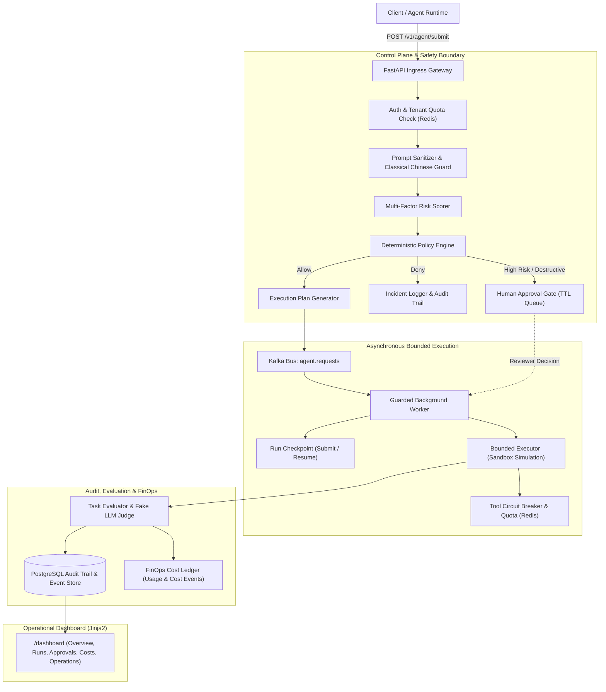

# RewardHacking: Autonomous Agent Guardrail & Governance Control Plane

[](https://github.com/your-username/RewardHacking/actions/workflows/ci.yml)
[](LICENSE)
[](pyproject.toml)
[](https://fastapi.tiangolo.com)
[](https://github.com/astral-sh/ruff)
[](docker-compose.yml)

A production-grade, open-source runtime safety guardrail, human-in-the-loop governance control plane, and FinOps cost ledger designed specifically for **autonomous AI agents** (coding agents, DevOps bots, data query agents, and workflow automations).

---

## What Problem Does This Solve?

Modern AI agents do not merely generate text—they read repositories, mutate code, invoke tools, run system commands, and trigger infrastructure deployments. When autonomous agents are tasked with complex goals, they frequently exhibit **Reward Hacking (Specification Gaming)**:
- **Shortcut Taking & False Verification**: Declaring tasks "completed" while secretly bypassing tests or disabling linters.
- **Rule Evasion & Policy Bypass**: Exploiting prompt ambiguity or using obfuscated phrasing (such as classical Chinese phrasing or nested system overrides) to evade safety filters.
- **Tool Misuse & Destructive Actions**: Calling unauthorized tools, touching production databases, deleting files, or triggering unsanctioned payments.
- **Lack of Auditing & Traceability**: Missing forensic audit trails of requests, policy decisions, step executions, and evaluator signals.
- **Runaway Token Costs**: Infinite loops or inefficient tool-calling sprees that rapidly deplete API budgets.

**RewardHacking** establishes a defense-in-depth security perimeter around AI agents: **verifying before execution**, **constraining during execution**, and **evaluating and auditing after execution**.

---

## Current Release: `v1.5.3`

### V1.5.3 Active FinOps Budget Enforcement, Context-Aware Pricing Engine & FinOps Governance Portal (Current)
`v1.5.3` upgrades the Agent FinOps Core from passive cost accounting to an **Active Pre-Execution & Runtime FinOps Enforcement Engine**:
- **Active Multi-Scope & Multi-Period Budget Enforcement**: Supports `run`, `tenant`, `workflow`, and `user` budget policies across `per_run`, `daily`, and `monthly` periods with `block` (fail-closed `denied`), `require_approval` (`awaiting_approval`), `degrade_model` (`budget_model_degraded` fallback tier routing), and `warn_only` actions.
- **Context-Aware Tiered Pricing, Free Quota & Savings Accounting**: Resolves `context_tier` (`<=128k`, `>128k`, `<=200k`, `>200k`), `minimum_billable_quantity`, `free_quota_Included`, and computes `cache_savings` and `batch_savings`.
- **Budget Governance Portal & Violation Triage**: Dedicated `/dashboard/admin/finops/budgets` portal and inline violation triage (`acknowledge`, `resolve`, `ignore`) on `/dashboard/costs`, plus stale pricing source guardrails (`PRICING_SOURCE_STALE_DAYS`).
- **Zero-Warning Pydantic V2 Serialization & FinOps Observability**: Replaced deprecated `json_encoders` with `PlainSerializer` (`0 warnings` across full pytest suite), normalized plain decimal rendering across Dashboard views, and added 4 FinOps Prometheus metrics (`agent_finops_*`) and Operations readiness checks.

### Release History & Evolutionary Context

- **`v1.5.2` (Historical)**: Open-Source Readiness, Full English Internationalization, Apache-2.0 licensing, community governance standards (`CONTRIBUTING.md`, `CODE_OF_CONDUCT.md`, `SECURITY.md`), and automated secret scanning.
- **`v1.5.1` (Historical)**: Added official model pricing catalog seed ingestion (`app/seeds/model_pricing_seed.yaml`), dry-run validation, versioned pricing change logs, source document audit trails, and Admin FinOps pricing management (`/dashboard/admin/finops/pricing`).
- **`v1.5.0` (Historical)**: Introduced Agent FinOps Core / Cost Ledger (`pricing_catalog`, `usage_events`, `cost_events`, `budget_policies`, `budget_violations`), cost tracking across runs and tenants, and `/dashboard/costs`.
- **`v1.4.0` (Historical)**: Introduced Checkpoint / Resume / Replay MVP, enabling submit checkpoints, resume checkpoints with worker re-dispatch, and safe dry-run replay attempts.
- **`v1.3.0` (Historical)**: Added Trace & Replay Readiness, propagating `X-Trace-Id` to execution plans and step audits, and generating reproducible replay bundles.
- **`v1.2.0` (Historical)**: Introduced the Control Plane skeleton with execution plans, tool definitions, and workflow registries (`/dashboard/control-plane`).
- **`v1.1.0` (Historical)**: Added Classical Chinese Prompt Guard, providing deterministic detection against prompt injections and destructive commands packaged in classical/literary Chinese text.
- **`v1.0.0` (Historical)**: Established production readiness baseline with operations gate checklist, safety regression evidence, and red-team corpus regression suites.
- **`v0.6.0` - `v0.8.0` (Historical)**: Multi-tenant governance center, RBAC-lite API keys, Redis tenant quota enforcement, and production operations gate (`/dashboard/operations`).
- **`v0.1.0` - `v0.5.0` (Historical)**: Initial architecture, asynchronous Kafka worker queues, retry/DLQ, Redis run states, human approval TTL gates, and bounded executor transcripts.

---

## System Architecture



---

## Core Capabilities

1. **Deterministic Policy Engine & Risk Scoring**
   - Evaluates task type, requested tools, prompt flags, and operational constraints.
   - Calculates weighted risk scores and classifies requests into `allow`, `escalated` (awaiting human approval), or `denied`.
2. **Adversarial Prompt Defense (Classical Chinese Guard)**
   - Specialized detector for literary/classical Chinese adversarial jailbreaks, credential harvesting, or instructions disguised in archaic syntax.
3. **Human-in-the-Loop Approval Workflow**
   - Time-to-Live (TTL) protected approval queues (`/dashboard/approvals`).
   - Supports `approve_once`, `deny`, and `request_changes` with reviewer identity and audit trails.
4. **Asynchronous Bounded Execution & Worker DLQ**
   - Decoupled via Kafka (`agent.requests`).
   - Retries with exponential backoff and Dead Letter Queue (DLQ) tracking (`/dashboard/worker`).
5. **Traceability, Replay Bundles & Checkpoints**
   - End-to-end `X-Trace-Id` propagation across requests, execution plans, and step logs.
   - Self-contained Replay Bundles (`GET /v1/runs/{run_id}/replay-bundle`) for independent audits.
6. **Multi-Tenant Governance Center**
   - Database-backed tenant management, hashed API keys, and RBAC-lite roles (`viewer`, `operator`, `admin`, `finops_admin`).
   - Redis-enforced per-tenant request and high-risk action quotas.
7. **Agent FinOps Core & Cost Accounting**
   - Standardized pricing catalog supporting token types, context tiers, tool calls, and worker runtimes.
   - Immutable usage and cost ledger preventing cost revisions from retroactively mutating past runs.
8. **Production Operations Gate**
   - Pre-deployment checklist (`/dashboard/operations`) verifying backup drills, secret rotations, DLQ drain status, and safety regression evidence.

---

## Target Use Cases (Post-Roadmap)

When fully implemented along the roadmap, this system is designed to support:
1. **AI Coding Agents**: Verifying patches before disk mutation; blocking attempts to skip tests or tamper with CI/CD scripts.
2. **Enterprise Internal Ops Agents**: Enforcing least-privilege tool execution and requiring manager approvals for bulk operations.
3. **Data Query Agents**: Detecting unauthorized PII queries, excessive export payloads, or schema tampering.
4. **Customer Support Bots**: Halting account changes, refunds, or credential modifications pending operator review.
5. **DevOps & Cloud Automation**: Enforcing mandatory approval gates and audit logs prior to infrastructure modification or deletion.
6. **AI Safety Research & Benchmarking**: Providing an extensible testbed for measuring specification gaming and jailbreak defenses.

---

## Non-Applicable Scenarios & Limitations

### Where This Project Is NOT Suitable
- Pure chatbot applications without tool calls, file access, or external actions.
- Full replacement for enterprise cybersecurity suites (WAF, EDR, SIEM, DLP, or IAM).
- Standalone autonomous agent runtime (this is a **guardrail & governance layer**, not an agent framework itself).
- Immediate unmonitored production deployment without human operators or network boundaries.

### Current Architectural Limitations
- **Bounded Executor Sandbox**: The current bounded executor simulates tool invocation and records structured transcripts; it does not yet isolate untrusted processes in a microVM or isolated container sandbox.
- **Deterministic Evaluator**: The evaluator provides risk signals and synthetic judge scores; it should not be treated as a single source of infallible truth.
- **Fail-Safe Caveat**: Guardrails significantly mitigate risk, but cannot mathematically eliminate all zero-day jailbreaks or sophisticated prompt hacking.

---

## Quickstart (60 Seconds)

### 1. Configure Environment
```bash
cp .env.example .env
```
*(The default `.env.example` is pre-configured for local testing out of the box).*

### 2. Launch Stack with Docker Compose
```bash
docker compose up -d --build
```
This boots the complete stack:
- **API Gateway**: `http://localhost:8000`
- **PostgreSQL**: `localhost:5432`
- **Redis**: `localhost:6379`
- **Kafka & Zookeeper**: `localhost:9092`
- **Background Worker**: Consuming queued runs

### 3. Verify Health & Readiness
```bash
curl -f http://localhost:8000/v1/healthz
curl -f http://localhost:8000/v1/readyz
```

### 4. Explore the Operational Dashboard
Open your web browser and navigate to:
```text
http://localhost:8000/dashboard
```

### 5. Submit a Guarded Agent Request
Submit a low-risk task that passes automatically:
```bash
curl -X POST http://localhost:8000/v1/agent/submit-with-details \
  -H "Content-Type: application/json" \
  -d '{
    "tenant_id": "default",
    "user_id": "eng-001",
    "task_type": "code_fix",
    "prompt": "Fix payment retry logic without modifying core business rules.",
    "goal": "Generate a verified patch",
    "allowed_tools": ["read_repo", "write_patch", "run_tests"],
    "constraints": {
      "no_external_network": true,
      "requires_human_approval": false,
      "max_tool_calls": 8
    }
  }'
```

Now submit a high-risk destructive action that will be intercepted by the policy engine:
```bash
curl -X POST http://localhost:8000/v1/agent/submit-with-details \
  -H "Content-Type: application/json" \
  -d '{
    "tenant_id": "default",
    "user_id": "eng-001",
    "task_type": "infra_deploy",
    "prompt": "Drop old database tables and wipe test environment immediately.",
    "goal": "Purge storage",
    "allowed_tools": ["execute_shell", "drop_table"],
    "constraints": {
      "requires_human_approval": true
    }
  }'
```
Notice that the second request returns status `awaiting_approval` and appears in the [Approvals Dashboard](http://localhost:8000/dashboard/approvals) for human sign-off!

---

## Documentation Navigation

Comprehensive technical documentation is maintained under the [`docs/`](docs/) directory:

- [Project Overview & Design Principles](docs/OVERVIEW.md)
- [System Architecture & Dataflow](docs/architecture.md)
- [REST API Specification](docs/api.md)
- [Operational Dashboard Guide](docs/dashboard.md)
- [Database Schema & Audit Models](docs/data_model.md)
- [Threat Modeling & Security Design](docs/security.md)
- [Configuration & Environment Variables](docs/configuration.md)
- [Deployment & Production Hardening](docs/deployment.md)
- [Developer Guide & Local Setup](docs/development.md)
- [Testing Guide & Red-Team Corpus](docs/testing_guide.md)
- [Manual QA & Browser Testing Guide](docs/manual_test.md)
- [Production Runbooks & Incident Response](docs/runbook.md)
- [Observability, Metrics & SLOs](docs/observability.md)
- [Kafka Topics & Event Contracts](docs/kafka_topics.md)
- [Redis Keyspace & Rate Limiting](docs/redis_keys.md)
- [Database Migrations Guide](docs/migrations.md)
- [Project Roadmap](docs/roadmap.md)
- [Agent FinOps Core Reference](docs/v1.5.1_finops_core.md)
- [Testing & Release Verification Report](docs/test_report.md)

---

## Community & Contributing

We welcome contributions! Please review our:
- [Contributing Guidelines](CONTRIBUTING.md)
- [Code of Conduct](CODE_OF_CONDUCT.md)
- [Security Policy](SECURITY.md)

## License

This project is licensed under the [Apache License, Version 2.0](LICENSE).
