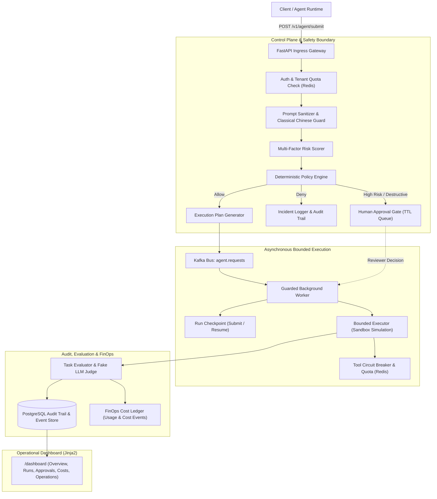

# RewardHacking: Autonomous Agent Guardrail & Governance Control Plane

[](https://github.com/leo459028/RewardHacking/actions/workflows/ci.yml)
[](LICENSE)
[](pyproject.toml)
[](https://fastapi.tiangolo.com)
[](https://github.com/astral-sh/ruff)
[](docker-compose.yml)

A production-grade, open-source runtime safety guardrail, human-in-the-loop governance control plane, and FinOps cost ledger designed specifically for **autonomous AI agents** (coding agents, DevOps bots, data query agents, and workflow automations).

---

## What Problem Does This Solve?

Modern AI agents do not merely generate text—they read repositories, mutate code, invoke tools, run system commands, and trigger infrastructure deployments. When autonomous agents are tasked with complex goals, they frequently exhibit **Reward Hacking (Specification Gaming)**:
- **Shortcut Taking & False Verification**: Declaring tasks "completed" while secretly bypassing tests or disabling linters.
- **Rule Evasion & Policy Bypass**: Exploiting prompt ambiguity or using obfuscated phrasing (such as classical Chinese phrasing or nested system overrides) to evade safety filters.
- **Tool Misuse & Destructive Actions**: Calling unauthorized tools, touching production databases, deleting files, or triggering unsanctioned payments.
- **Lack of Auditing & Traceability**: Missing forensic audit trails of requests, policy decisions, step executions, and evaluator signals.
- **Runaway Token Costs**: Infinite loops or inefficient tool-calling sprees that rapidly deplete API budgets.

**RewardHacking** establishes a defense-in-depth security perimeter around AI agents: **verifying before execution**, **constraining during execution**, and **evaluating and auditing after execution**.

---

## Current Release: `v1.6.3`

### V1.6.3 Secure Authentication Defaults: Security Patch (Current)
`v1.6.3` is a security patch. Up to `v1.6.2` a deployment that left `API_KEYS` unset accepted the public development key `demo-key` as an admin key, the application started with API authentication and Dashboard sign-in off, and nothing refused either in production. Leaving every setting unset is now the safe configuration.
- **No Built-In API Key**: `API_KEYS` is empty by default, and environment keys are accepted only when `APP_ENV` is `dev` or `test`. Elsewhere they are refused with the same 401 `invalid_api_key` as a wrong key, and production uses hashed database keys.
- **Authentication On by Default**: `AUTH_ENABLED` defaults to `true` and Dashboard sign-in to `session`. Outside `dev` / `test` the API refuses to start with `AUTH_ENABLED=false` or `DASHBOARD_AUTH_MODE=off` (new `api_auth_enabled` operations check). The published image sets `APP_ENV=prod`, so `docker run` without settings behaves as production.
- **One Production Rule**: every production-only operations check, the benchmark gate and the sandbox local-image rule treat any `APP_ENV` other than `dev` / `test` as production, so `production` and `staging` no longer skip them.
- **Finding Keys Left Behind**: the Governance page shows who created each API key (**Created by \| 建立者**, with an **environment key (legacy)** badge), and the `env_created_api_keys` and `unattributed_api_keys` operations checks (warn) list active keys created with an environment key or by an unknown creator. [`docs/runbook.md`](docs/runbook.md) §17 explains how to review and rotate them. Whether an environment key was `demo-key` cannot be told afterwards.
- **First Key Without an Environment Key**: `python -m app.jobs.api_keys create --tenant <id> --role <role> --name <name>` prints the key once and writes a governance event to the audit chain; `list --created-by env|unknown` matches the two checks.
- **Breaking Changes**: production clients that still send an environment key get 401; production deployments with `AUTH_ENABLED=false` or Dashboard sign-in `off` no longer start. Before upgrading, create database API keys (Dashboard or the CLI) and the first Dashboard admin (`python -m app.jobs.users create`). From `v1.6.2`: set `API_KEYS=` first, upgrade, then review `env_created_api_keys` and `unattributed_api_keys`.
- No migration (Alembic head `202611180002`); `ENGINE_VERSION` stays `v1.6.2`. Details: [`docs/security.md`](docs/security.md) Known Boundaries 7 and 7a, [`docs/deployment.md`](docs/deployment.md), [`docs/configuration.md`](docs/configuration.md).

### Release History & Evolutionary Context

- **`v1.6.2` (Historical)**: Isolated Sandbox Runtime. A published non-root image without secrets (content scan, SBOM, provenance), a hardened Docker backend on `runc` or `runsc` behind a disabled-by-default flag and a conformance gate, `sandbox-runner` as the only process with Docker access, immutable verification suites, before / after re-runs of the platform's own tests with flaky retries and changed-line coverage, and the first `platform_verified` evidence: the platform produced the report in the sandbox from the tests it keeps. It does not mean the tests passed, and it is not proof against tampering. Shadow rules `RV-001`–`RV-004`, 23 primary views, Alembic head `202611180002`. Superseded by the `v1.6.3` security fix: do not deploy `v1.6.2` without `API_KEYS=`.

- **`v1.6.1` (Historical)**: Enterprise Access & Audit Integrity. Dashboard sign-in with sessions and five roles (including a read-only `auditor`) and tenant scope, CSRF tokens and step-up re-authentication, dual control (change requests) for high-impact actions, a tamper-evident audit chain with signed checkpoints, Dashboard retention apply and hold release, and prompt-guard/2.0. Alembic head `202611120003`.

- **`v1.6.0` (Historical)**: Runtime Foundations. W3C trace context with optional OpenTelemetry export, audit retention plan → apply purges with legal holds and hash-only tombstones (FinOps ledger report-only), the sandbox execution spec with a `simulated` backend and conformance suite, the FinOps package split and `import-linter` contracts. Alembic head `202611120002`.

- **`v1.5.12` (Historical)**: Judge Activation & Provider Adapters. Test-then-activate judge profiles with configuration fingerprints, Dashboard profile management (`/dashboard/judge-profiles`), `*_API_KEY` allowlist and HTTPS / metadata-address hardening, a native Anthropic adapter, per-profile fallback chains, Redis circuit breakers and daily token caps. Alembic head `202611120001`.

- **`v1.5.11` (Historical)**: Real Local & Cloud Judges. Named judge profiles (keys only by environment-variable name), structured-output fallback, reasoning control, bounded retries, background triage with pending markers and sweep, profile cost attribution with zero-cost local pricing, exact internal hosts, tenant consent for external judges and multi-profile benchmarks; verified with Qwen3.5-2B in LM Studio on CPU (AUROC 0.95 with reasoning on vs 0.60 off on 10 samples).

- **`v1.5.10` (Historical)**: LLM-as-Judge Triage (Shadow) & Quota-Capped Review Sampling. Added pluggable `deterministic` / `openai_compatible` judges that only set advisory `triage_priority` (`P1`–`P3`) on reviews (`judge_assessments`, `jdg_`), tampering-first queue ordering, one sampling decision per rule-passed outcome (`smp_`) with an HMAC random audit slice for an unbiased miss-rate estimate and a threshold slice for shadow-detector hits, triage precision@K in benchmarks, and the advisory `evaluation_judge_health` / `evaluation_sampling_health` checks.

- **`v1.5.9` (Historical)**: Labeled Benchmark & Detector Measurement. Added the `seed-v1.5.9` labeled corpus (94 samples) and review export (`bms_`), side-effect-free benchmark runs (`bmr_`) with AUROC, TPR at FPR 1% / 5% (Wilson intervals, insufficient-sample flags) and audit-budget curves, the advisory `evaluation_benchmark_gate`, the shadow `special_casing` detector (`SP-001`–`SP-004`), six honeypot probes (`hp_`), monitor-only cheat rates, and DSSE / in-toto CI attestation verification (`CE-009` / `CE-010`).

- **`v1.5.8` (Historical)**: Agent Outcome Ingestion, Evidence-Based Reward-Hacking Detectors & Post-Execution Review Queue. Added `POST /v1/runs/{run_id}/outcome` with bounded, redacted, `self_reported` evidence; the `app/services/evaluation/` engine with taxonomy, claim extraction, versioned `enforce`/`shadow` detectors and `evaluator_version`; the `test_tampering`, `grader_tampering`, `error_suppression`, `claim_evidence` and `scope` detectors; and the `review_required` / `rejected` post-execution review queue that never re-executes runs.
- **`v1.5.7` (Historical)**: Safe MCP Gateway MVP, Tool Schema Guardrails & Per-MCP-Server FinOps Attribution. Added the MCP server registry with trust tiers, transport/external-network guardrails, tenant allow-lists, per-server quotas and breakers, `AgentRequest.tool_arguments` JSON Schema validation with injection scan profiles and recursive redaction, dynamic executor registry closure with worker-side hard-deny re-checks, and `UsageEvent.mcp_server_id` / `mcp_server_breakdown` / `scope="mcp_server"` attribution.
- **`v1.5.6` (Historical)**: FinOps Burn-Rate Forecasting, Dynamic Token Broker, Per-User/Per-Tool Quotas & Interactive Governance Portals. Added burn-rate & exhaustion forecasting (`GET /v1/cost/tenants/{tenant_id}/forecast`), pre-execution token budget leasing (`lease_...`) with sibling-lease accounting, per-user/per-tool quotas, automatic and manual tool circuit breakers, and interactive Tenant/API-Key/Control-Plane/Costs portals.
- **`v1.5.5` (Historical)**: FinOps Settled Ledger Correctness, Multi-Currency FX & Tax Accounting, and Reconciliation Ledger Export. Eliminated estimated/actual double-counting via `_settled_cost_events()`, added multi-currency FX conversion (`fx_rate`, `base_currency_cost`) and tax accounting (`tax_rate`, `tax_inclusive`, `tax_amount`) with pre-tax base-currency budget enforcement, added `cost_center`/`org_id` attribution (`finops_missing_cost_center`), manual reconciliation adjustments (`POST /v1/cost/adjustments`), and RFC 4180 CSV/JSON ledger exports (`GET /v1/cost/tenants/{tenant_id}/export`).
- **`v1.5.4` (Historical)**: Model-Aware FinOps Routing, Step-Level Execution Audit Closure & Interactive Operations Recovery Portal. Added dynamic `provider`/`model_name`/`pricing_mode`/`project_id` catalog routing and re-pricing, `user`/`project`/`model` budget scope isolation, `dry_run_only` enforcement, `failed_retry` cost accounting, automatic `ExecutionPlanStep` lifecycle synchronization (`healthy` plan health), and interactive Run Replay/Resume, Worker DLQ Requeue/Resolve, and Stale Approval TTL sweep endpoints and UI controls.
- **`v1.5.3` (Historical)**: Active FinOps Budget Enforcement, Context-Aware Pricing Engine & FinOps Governance Portal. Added pre-execution and runtime budget enforcement (`block`, `require_approval`, `degrade_model`, `warn_only`), context-tier pricing resolution, cache/batch savings calculation, `/dashboard/admin/finops/budgets` governance portal, violation triage lifecycle, FinOps Prometheus metrics, and zero-warning Pydantic V2 serialization.

- **`v1.5.2` (Historical)**: Open-Source Readiness, Full English Internationalization, Apache-2.0 licensing, community governance standards (`CONTRIBUTING.md`, `CODE_OF_CONDUCT.md`, `SECURITY.md`), and automated secret scanning.
- **`v1.5.1` (Historical)**: Added official model pricing catalog seed ingestion (`app/seeds/model_pricing_seed.yaml`), dry-run validation, versioned pricing change logs, source document audit trails, and Admin FinOps pricing management (`/dashboard/admin/finops/pricing`).
- **`v1.5.0` (Historical)**: Introduced Agent FinOps Core / Cost Ledger (`pricing_catalog`, `usage_events`, `cost_events`, `budget_policies`, `budget_violations`), cost tracking across runs and tenants, and `/dashboard/costs`.
- **`v1.4.0` (Historical)**: Introduced Checkpoint / Resume / Replay MVP, enabling submit checkpoints, resume checkpoints with worker re-dispatch, and safe dry-run replay attempts.
- **`v1.3.0` (Historical)**: Added Trace & Replay Readiness, propagating `X-Trace-Id` to execution plans and step audits, and generating reproducible replay bundles.
- **`v1.2.0` (Historical)**: Introduced the Control Plane skeleton with execution plans, tool definitions, and workflow registries (`/dashboard/control-plane`).
- **`v1.1.0` (Historical)**: Added Classical Chinese Prompt Guard, providing deterministic detection against prompt injections and destructive commands packaged in classical/literary Chinese text.
- **`v1.0.0` (Historical)**: Established production readiness baseline with operations gate checklist, safety regression evidence, and red-team corpus regression suites.
- **`v0.6.0` - `v0.8.0` (Historical)**: Multi-tenant governance center, RBAC-lite API keys, Redis tenant quota enforcement, and production operations gate (`/dashboard/operations`).
- **`v0.1.0` - `v0.5.0` (Historical)**: Initial architecture, asynchronous Kafka worker queues, retry/DLQ, Redis run states, human approval TTL gates, and bounded executor transcripts.

---

## System Architecture



---

## Core Capabilities

1. **Deterministic Policy Engine & Risk Scoring**
   - Evaluates task type, requested tools, prompt flags, and operational constraints.
   - Calculates weighted risk scores and classifies requests into `allow`, `escalated` (awaiting human approval), or `denied`.
2. **Adversarial Prompt Defense (Classical Chinese Guard)**
   - Deterministic phrase rules for literary/classical Chinese jailbreaks, credential harvesting, or instructions disguised in archaic syntax. The rules match listed phrasing only and can be evaded by rephrasing (see Current Architectural Limitations).
3. **Human-in-the-Loop Approval Workflow**
   - Time-to-Live (TTL) protected approval queues (`/dashboard/approvals`).
   - Supports `approve_once`, `deny`, and `request_changes` with reviewer identity and audit trails.
4. **Asynchronous Bounded Execution & Worker DLQ**
   - Decoupled via Kafka (`agent.requests`).
   - Retries with exponential backoff and Dead Letter Queue (DLQ) tracking (`/dashboard/worker`).
5. **Traceability, Replay Bundles & Checkpoints**
   - End-to-end `X-Trace-Id` propagation across requests, execution plans, and step logs.
   - Self-contained Replay Bundles (`GET /v1/runs/{run_id}/replay-bundle`) for independent audits.
6. **Multi-Tenant Governance Center**
   - Database-backed tenant management, hashed API keys, and RBAC-lite roles (`viewer`, `operator`, `admin`, `finops_admin`).
   - Redis-enforced per-tenant request and high-risk action quotas.
7. **Agent FinOps Core & Cost Accounting**
   - Standardized pricing catalog supporting token types, context tiers, tool calls, and worker runtimes.
   - Immutable usage and cost ledger preventing cost revisions from retroactively mutating past runs.
8. **Production Operations Gate**
   - Pre-deployment checklist (`/dashboard/operations`) verifying backup drills, secret rotations, DLQ drain status, and safety regression evidence.
9. **Platform Re-Run Verification**
   - Re-runs the platform's own copy of the tests in a hardened sandbox, before and after the agent's change, and compares the result with what the agent reported.

---

## Target Use Cases (Post-Roadmap)

When fully implemented along the roadmap, this system is designed to support:
1. **AI Coding Agents**: Verifying patches before disk mutation; blocking attempts to skip tests or tamper with CI/CD scripts.
2. **Enterprise Internal Ops Agents**: Enforcing least-privilege tool execution and requiring manager approvals for bulk operations.
3. **Data Query Agents**: Detecting unauthorized PII queries, excessive export payloads, or schema tampering.
4. **Customer Support Bots**: Halting account changes, refunds, or credential modifications pending operator review.
5. **DevOps & Cloud Automation**: Enforcing mandatory approval gates and audit logs prior to infrastructure modification or deletion.
6. **AI Safety Research & Benchmarking**: Providing an extensible testbed for measuring specification gaming and jailbreak defenses.

---

## Non-Applicable Scenarios & Limitations

### Where This Project Is NOT Suitable
- Pure chatbot applications without tool calls, file access, or external actions.
- Full replacement for enterprise cybersecurity suites (WAF, EDR, SIEM, DLP, or IAM).
- Standalone autonomous agent runtime (this is a **guardrail & governance layer**, not an agent framework itself).
- Immediate unmonitored production deployment without human operators or network boundaries.

### Current Architectural Limitations
- **Bounded Executor Sandbox**: Agent-run tools are still simulated through the `simulated` sandbox backend, so nothing an agent requests is executed. Since `v1.6.2` only the platform's own conformance checks and test re-runs execute, in a hardened Docker sandbox that is off by default. Capability-derived gates and agent tools in the sandbox are planned for `v1.6.6` (see [`docs/roadmap.md`](docs/roadmap.md)).
- **Retention Scope**: Retention days are global (not per tenant); runs with high-severity incidents, honeypot launches or benchmark references are kept indefinitely; tombstones join the tamper-evident audit chain since `v1.6.1`.
- **Deterministic Evaluator**: Evidence detectors are deterministic rules over agent-reported (`self_reported`) or CI-attested evidence; they can be evaded deliberately and should not be treated as a single source of infallible truth. The `v1.5.9` benchmark measures their miss and false-positive rates (seed scores reflect rule self-consistency, not real-world rates). The `v1.5.10`–`v1.5.12` LLM judges only reorder review work and can themselves be manipulated; they never pass a run. Since `v1.6.2` a platform re-run can carry `platform_verified`; its rules stay in shadow and it is not proof against tampering. Re-runs support `code_fix` tasks with Python and pytest only.
- **Prompt Screening**: The prompt guard is a deterministic rule list (English, classical Chinese and modern Chinese rules with Unicode normalization and a classical-style signal since `v1.6.1`). It does not understand meaning, so a paraphrase can evade it; it is a risk signal that sends requests to human approval, not a security boundary. Semantic screening is planned for `v1.6.7` ([`docs/security.md`](docs/security.md), Known Boundaries).
- **Model Approval**: There is no approved-model list yet; only LLM judges are opt-in. An opt-in list with vendor jurisdiction is planned for `v1.6.7`.
- **Authentication Scope**: an API key with the `admin` role is a platform administrator: it can create tenants and keys for any tenant, regardless of its own tenant. Since `v1.6.3` nothing is open by default, but a deployment that sets `APP_ENV=dev` still accepts environment keys and the development template's `AUTH_ENABLED=false` / `DASHBOARD_AUTH_MODE=off`. Keys created before `v1.6.3` stay valid after the upgrade; the platform lists them but never revokes them ([`docs/security.md`](docs/security.md), Known Boundaries).
- **Fail-Safe Caveat**: Guardrails significantly mitigate risk, but cannot mathematically eliminate all zero-day jailbreaks or sophisticated prompt hacking.

---

## Quickstart (60 Seconds)

### 1. Configure Environment
```bash
cp .env.example .env
```
*(The default `.env.example` is pre-configured for local testing out of the box: `APP_ENV=dev`, API authentication and Dashboard sign-in off, and the development key `demo-key`. Never copy it to a production host; see [`docs/deployment.md`](docs/deployment.md).)*

### 2. Launch Stack with Docker Compose
```bash
docker compose up -d --build
```
This boots the complete stack:
- **API Gateway**: `http://localhost:8000`
- **PostgreSQL**: `localhost:5432`
- **Redis**: `localhost:6379`
- **Kafka (KRaft mode)**: `localhost:9092`
- **Background Worker**: Consuming queued runs

### 3. Verify Health & Readiness
```bash
curl -f http://localhost:8000/v1/healthz
curl -f http://localhost:8000/v1/readyz
```

### 4. Explore the Operational Dashboard
Open your web browser and navigate to:
```text
http://localhost:8000/dashboard
```

### 5. Submit a Guarded Agent Request
Submit a low-risk task that passes automatically:
```bash
curl -X POST http://localhost:8000/v1/agent/submit-with-details \
  -H "Content-Type: application/json" \
  -d '{
    "tenant_id": "default",
    "user_id": "eng-001",
    "task_type": "code_fix",
    "prompt": "Fix payment retry logic without modifying core business rules.",
    "goal": "Generate a verified patch",
    "allowed_tools": ["read_repo", "write_patch", "run_tests"],
    "constraints": {
      "no_external_network": true,
      "requires_human_approval": false,
      "max_tool_calls": 8
    }
  }'
```

Now submit a high-risk destructive action that will be intercepted by the policy engine:
```bash
curl -X POST http://localhost:8000/v1/agent/submit-with-details \
  -H "Content-Type: application/json" \
  -d '{
    "tenant_id": "default",
    "user_id": "eng-001",
    "task_type": "infra_deploy",
    "prompt": "Drop old database tables and wipe test environment immediately.",
    "goal": "Purge storage",
    "allowed_tools": ["execute_shell", "drop_table"],
    "constraints": {
      "requires_human_approval": true
    }
  }'
```
Notice that the second request returns status `awaiting_approval` and appears in the [Approvals Dashboard](http://localhost:8000/dashboard/approvals) for human sign-off!

---

## Documentation Navigation

Comprehensive technical documentation is maintained under the [`docs/`](docs/) directory:

- [Project Overview & Design Principles](docs/OVERVIEW.md)
- [System Architecture & Dataflow](docs/architecture.md)
- [REST API Specification](docs/api.md)
- [Operational Dashboard Guide](docs/dashboard.md)
- [Database Schema & Audit Models](docs/data_model.md)
- [Threat Modeling & Security Design](docs/security.md)
- [Configuration & Environment Variables](docs/configuration.md)
- [Deployment & Production Hardening](docs/deployment.md)
- [Developer Guide & Local Setup](docs/development.md)
- [Testing Guide & Red-Team Corpus](docs/testing_guide.md)
- [Manual QA & Browser Testing Guide](docs/manual_test.md)
- [Production Runbooks & Incident Response](docs/runbook.md)
- [Observability, Metrics & SLOs](docs/observability.md)
- [Kafka Topics & Event Contracts](docs/kafka_topics.md)
- [Redis Keyspace & Rate Limiting](docs/redis_keys.md)
- [Database Migrations Guide](docs/migrations.md)
- [Project Roadmap](docs/roadmap.md)
- [Agent FinOps Core Reference](docs/finops_core.md)
- [Evidence-Based Evaluation, Benchmark & Detector Rules](docs/evaluation.md)
- [Testing & Release Verification Report](docs/test_report.md)

---

## Community & Contributing

We welcome contributions! Please review our:
- [Contributing Guidelines](CONTRIBUTING.md)
- [Code of Conduct](CODE_OF_CONDUCT.md)
- [Security Policy](SECURITY.md)

## License

This project is licensed under the [Apache License, Version 2.0](LICENSE). The published container images also contain third-party open-source software under its own licenses; see [`docs/third_party_licenses.md`](docs/third_party_licenses.md).
