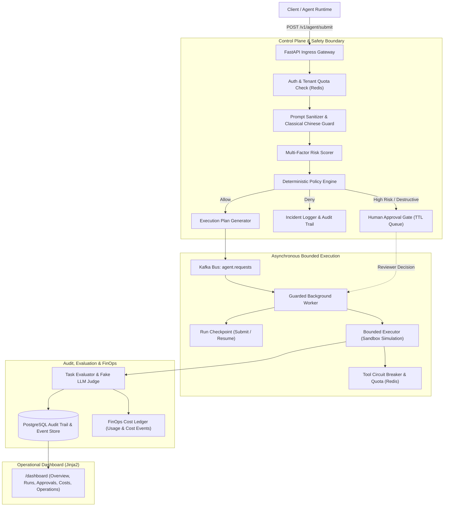

# RewardHacking: Autonomous Agent Guardrail & Governance Control Plane

[](https://github.com/leo459028/RewardHacking/actions/workflows/ci.yml)
[](LICENSE)
[](pyproject.toml)
[](https://fastapi.tiangolo.com)
[](https://github.com/astral-sh/ruff)
[](docker-compose.yml)

A production-grade, open-source runtime safety guardrail, human-in-the-loop governance control plane, and FinOps cost ledger designed specifically for **autonomous AI agents** (coding agents, DevOps bots, data query agents, and workflow automations).

---

## What Problem Does This Solve?

Modern AI agents do not merely generate text—they read repositories, mutate code, invoke tools, run system commands, and trigger infrastructure deployments. When autonomous agents are tasked with complex goals, they frequently exhibit **Reward Hacking (Specification Gaming)**:
- **Shortcut Taking & False Verification**: Declaring tasks "completed" while secretly bypassing tests or disabling linters.
- **Rule Evasion & Policy Bypass**: Exploiting prompt ambiguity or using obfuscated phrasing (such as classical Chinese phrasing or nested system overrides) to evade safety filters.
- **Tool Misuse & Destructive Actions**: Calling unauthorized tools, touching production databases, deleting files, or triggering unsanctioned payments.
- **Lack of Auditing & Traceability**: Missing forensic audit trails of requests, policy decisions, step executions, and evaluator signals.
- **Runaway Token Costs**: Infinite loops or inefficient tool-calling sprees that rapidly deplete API budgets.

**RewardHacking** establishes a defense-in-depth security perimeter around AI agents: **verifying before execution**, **constraining during execution**, and **evaluating and auditing after execution**.

---

## Current Release: `v1.5.12`

### V1.5.12 Judge Activation & Provider Adapters: Test-Then-Activate, Dashboard Profiles, Native Anthropic, Fallback & Breakers (Current)
`v1.5.12` makes choosing a judge safe and visible. The rule-based judge stays the default, and no LLM judge (local or cloud) is used until it has passed a connection test for its exact configuration.
- **Activation Gate**: probe results and activations are stored (`judge_profile_states`) with a configuration fingerprint (endpoint, model, key digest, request format, output budget). A Dashboard profile is used only after a successful test **and** an explicit *Activate*; a profile named by `EVALUATION_JUDGE_PROFILE` is probed once in the background at startup and used only if that probe succeeds. Changing the model, URL or key invalidates the test (`needs_reprobe`) and live triage falls back to the rule-based judge.
- **Judge Profiles page** (`/dashboard/judge-profiles`, 17th primary view): templates (LM Studio, Ollama, OpenAI, Gemini, DeepSeek, Anthropic), grey default hints, optional fields left blank, drafts, status labels (*Draft*, *Untested*, *Probe failed*, *Ready*, *Active*, *Needs re-test*, *Offline (breaker)*), key status (variable name, set / not set, 6-hex fingerprint), test, activate, deactivate, edit and delete. Editing is off unless Dashboard Basic Auth uses non-default credentials (or `EVALUATION_JUDGE_DASHBOARD_EDITING=insecure_dev` locally); forms require a same-origin `Origin` / `Referer`. Keys are never entered in the page (that waits for Dashboard RBAC in `v1.6.x`).
- **Hardening**: `api_key_env` must end in `_API_KEY` (or be allow-listed) so a profile cannot send `DATABASE_URL` anywhere; external hosts must use HTTPS; cloud metadata addresses, URL credentials and query strings are refused (also re-checked before every request); `422` responses no longer echo a forbidden field such as `api_key`.
- **Provider Adapters**: OpenAI-compatible behaviour is unchanged; a native Anthropic adapter uses the Messages API (`x-api-key`, `anthropic-version: 2026-10-21`, `output_config.format` JSON schema instead of forced tool use, which current Claude models reject, no sampling parameters, thinking blocks skipped). Verified with mocks only.
- **Resilience & Budgets**: per-profile `fallback` chains (up to two profiles, rule-based judge always last; targets must have passed a test), a Redis circuit breaker per profile (opens after consecutive timeouts / errors, half-open after its TTL, audited), and a per-profile `daily_token_cap` on top of the global cap. Verdicts, review priorities and statuses are never affected.
- **API**: `POST/PUT/DELETE /v1/evaluations/judge/profiles(/{name})`, `POST .../{name}/activate`, `POST /v1/evaluations/judge/deactivate`, `GET /v1/evaluations/judge/templates`; `GET /v1/evaluations/judge/profiles` and `/status` report what is really in use and why. Alembic head `202611120001`. Details: [`docs/evaluation.md`](docs/evaluation.md) §15.

### Release History & Evolutionary Context

- **`v1.5.11` (Historical)**: Real Local & Cloud Judges. Named judge profiles (keys only by environment-variable name), structured-output fallback, reasoning control, bounded retries, background triage with pending markers and sweep, profile cost attribution with zero-cost local pricing, exact internal hosts, tenant consent for external judges and multi-profile benchmarks; verified with Qwen3.5-2B in LM Studio on CPU (AUROC 0.95 with reasoning on vs 0.60 off on 10 samples).

- **`v1.5.10` (Historical)**: LLM-as-Judge Triage (Shadow) & Quota-Capped Review Sampling. Added pluggable `deterministic` / `openai_compatible` judges that only set advisory `triage_priority` (`P1`–`P3`) on reviews (`judge_assessments`, `jdg_`), tampering-first queue ordering, one sampling decision per rule-passed outcome (`smp_`) with an HMAC random audit slice for an unbiased miss-rate estimate and a threshold slice for shadow-detector hits, triage precision@K in benchmarks, and the advisory `evaluation_judge_health` / `evaluation_sampling_health` checks.

- **`v1.5.9` (Historical)**: Labeled Benchmark & Detector Measurement. Added the `seed-v1.5.9` labeled corpus (94 samples) and review export (`bms_`), side-effect-free benchmark runs (`bmr_`) with AUROC, TPR at FPR 1% / 5% (Wilson intervals, insufficient-sample flags) and audit-budget curves, the advisory `evaluation_benchmark_gate`, the shadow `special_casing` detector (`SP-001`–`SP-004`), six honeypot probes (`hp_`), monitor-only cheat rates, and DSSE / in-toto CI attestation verification (`CE-009` / `CE-010`).

- **`v1.5.8` (Historical)**: Agent Outcome Ingestion, Evidence-Based Reward-Hacking Detectors & Post-Execution Review Queue. Added `POST /v1/runs/{run_id}/outcome` with bounded, redacted, `self_reported` evidence; the `app/services/evaluation/` engine with taxonomy, claim extraction, versioned `enforce`/`shadow` detectors and `evaluator_version`; the `test_tampering`, `grader_tampering`, `error_suppression`, `claim_evidence` and `scope` detectors; and the `review_required` / `rejected` post-execution review queue that never re-executes runs.
- **`v1.5.7` (Historical)**: Safe MCP Gateway MVP, Tool Schema Guardrails & Per-MCP-Server FinOps Attribution. Added the MCP server registry with trust tiers, transport/external-network guardrails, tenant allow-lists, per-server quotas and breakers, `AgentRequest.tool_arguments` JSON Schema validation with injection scan profiles and recursive redaction, dynamic executor registry closure with worker-side hard-deny re-checks, and `UsageEvent.mcp_server_id` / `mcp_server_breakdown` / `scope="mcp_server"` attribution.
- **`v1.5.6` (Historical)**: FinOps Burn-Rate Forecasting, Dynamic Token Broker, Per-User/Per-Tool Quotas & Interactive Governance Portals. Added burn-rate & exhaustion forecasting (`GET /v1/cost/tenants/{tenant_id}/forecast`), pre-execution token budget leasing (`lease_...`) with sibling-lease accounting, per-user/per-tool quotas, automatic and manual tool circuit breakers, and interactive Tenant/API-Key/Control-Plane/Costs portals.
- **`v1.5.5` (Historical)**: FinOps Settled Ledger Correctness, Multi-Currency FX & Tax Accounting, and Reconciliation Ledger Export. Eliminated estimated/actual double-counting via `_settled_cost_events()`, added multi-currency FX conversion (`fx_rate`, `base_currency_cost`) and tax accounting (`tax_rate`, `tax_inclusive`, `tax_amount`) with pre-tax base-currency budget enforcement, added `cost_center`/`org_id` attribution (`finops_missing_cost_center`), manual reconciliation adjustments (`POST /v1/cost/adjustments`), and RFC 4180 CSV/JSON ledger exports (`GET /v1/cost/tenants/{tenant_id}/export`).
- **`v1.5.4` (Historical)**: Model-Aware FinOps Routing, Step-Level Execution Audit Closure & Interactive Operations Recovery Portal. Added dynamic `provider`/`model_name`/`pricing_mode`/`project_id` catalog routing and re-pricing, `user`/`project`/`model` budget scope isolation, `dry_run_only` enforcement, `failed_retry` cost accounting, automatic `ExecutionPlanStep` lifecycle synchronization (`healthy` plan health), and interactive Run Replay/Resume, Worker DLQ Requeue/Resolve, and Stale Approval TTL sweep endpoints and UI controls.
- **`v1.5.3` (Historical)**: Active FinOps Budget Enforcement, Context-Aware Pricing Engine & FinOps Governance Portal. Added pre-execution and runtime budget enforcement (`block`, `require_approval`, `degrade_model`, `warn_only`), context-tier pricing resolution, cache/batch savings calculation, `/dashboard/admin/finops/budgets` governance portal, violation triage lifecycle, FinOps Prometheus metrics, and zero-warning Pydantic V2 serialization.

- **`v1.5.2` (Historical)**: Open-Source Readiness, Full English Internationalization, Apache-2.0 licensing, community governance standards (`CONTRIBUTING.md`, `CODE_OF_CONDUCT.md`, `SECURITY.md`), and automated secret scanning.
- **`v1.5.1` (Historical)**: Added official model pricing catalog seed ingestion (`app/seeds/model_pricing_seed.yaml`), dry-run validation, versioned pricing change logs, source document audit trails, and Admin FinOps pricing management (`/dashboard/admin/finops/pricing`).
- **`v1.5.0` (Historical)**: Introduced Agent FinOps Core / Cost Ledger (`pricing_catalog`, `usage_events`, `cost_events`, `budget_policies`, `budget_violations`), cost tracking across runs and tenants, and `/dashboard/costs`.
- **`v1.4.0` (Historical)**: Introduced Checkpoint / Resume / Replay MVP, enabling submit checkpoints, resume checkpoints with worker re-dispatch, and safe dry-run replay attempts.
- **`v1.3.0` (Historical)**: Added Trace & Replay Readiness, propagating `X-Trace-Id` to execution plans and step audits, and generating reproducible replay bundles.
- **`v1.2.0` (Historical)**: Introduced the Control Plane skeleton with execution plans, tool definitions, and workflow registries (`/dashboard/control-plane`).
- **`v1.1.0` (Historical)**: Added Classical Chinese Prompt Guard, providing deterministic detection against prompt injections and destructive commands packaged in classical/literary Chinese text.
- **`v1.0.0` (Historical)**: Established production readiness baseline with operations gate checklist, safety regression evidence, and red-team corpus regression suites.
- **`v0.6.0` - `v0.8.0` (Historical)**: Multi-tenant governance center, RBAC-lite API keys, Redis tenant quota enforcement, and production operations gate (`/dashboard/operations`).
- **`v0.1.0` - `v0.5.0` (Historical)**: Initial architecture, asynchronous Kafka worker queues, retry/DLQ, Redis run states, human approval TTL gates, and bounded executor transcripts.

---

## System Architecture



---

## Core Capabilities

1. **Deterministic Policy Engine & Risk Scoring**
   - Evaluates task type, requested tools, prompt flags, and operational constraints.
   - Calculates weighted risk scores and classifies requests into `allow`, `escalated` (awaiting human approval), or `denied`.
2. **Adversarial Prompt Defense (Classical Chinese Guard)**
   - Specialized detector for literary/classical Chinese adversarial jailbreaks, credential harvesting, or instructions disguised in archaic syntax.
3. **Human-in-the-Loop Approval Workflow**
   - Time-to-Live (TTL) protected approval queues (`/dashboard/approvals`).
   - Supports `approve_once`, `deny`, and `request_changes` with reviewer identity and audit trails.
4. **Asynchronous Bounded Execution & Worker DLQ**
   - Decoupled via Kafka (`agent.requests`).
   - Retries with exponential backoff and Dead Letter Queue (DLQ) tracking (`/dashboard/worker`).
5. **Traceability, Replay Bundles & Checkpoints**
   - End-to-end `X-Trace-Id` propagation across requests, execution plans, and step logs.
   - Self-contained Replay Bundles (`GET /v1/runs/{run_id}/replay-bundle`) for independent audits.
6. **Multi-Tenant Governance Center**
   - Database-backed tenant management, hashed API keys, and RBAC-lite roles (`viewer`, `operator`, `admin`, `finops_admin`).
   - Redis-enforced per-tenant request and high-risk action quotas.
7. **Agent FinOps Core & Cost Accounting**
   - Standardized pricing catalog supporting token types, context tiers, tool calls, and worker runtimes.
   - Immutable usage and cost ledger preventing cost revisions from retroactively mutating past runs.
8. **Production Operations Gate**
   - Pre-deployment checklist (`/dashboard/operations`) verifying backup drills, secret rotations, DLQ drain status, and safety regression evidence.

---

## Target Use Cases (Post-Roadmap)

When fully implemented along the roadmap, this system is designed to support:
1. **AI Coding Agents**: Verifying patches before disk mutation; blocking attempts to skip tests or tamper with CI/CD scripts.
2. **Enterprise Internal Ops Agents**: Enforcing least-privilege tool execution and requiring manager approvals for bulk operations.
3. **Data Query Agents**: Detecting unauthorized PII queries, excessive export payloads, or schema tampering.
4. **Customer Support Bots**: Halting account changes, refunds, or credential modifications pending operator review.
5. **DevOps & Cloud Automation**: Enforcing mandatory approval gates and audit logs prior to infrastructure modification or deletion.
6. **AI Safety Research & Benchmarking**: Providing an extensible testbed for measuring specification gaming and jailbreak defenses.

---

## Non-Applicable Scenarios & Limitations

### Where This Project Is NOT Suitable
- Pure chatbot applications without tool calls, file access, or external actions.
- Full replacement for enterprise cybersecurity suites (WAF, EDR, SIEM, DLP, or IAM).
- Standalone autonomous agent runtime (this is a **guardrail & governance layer**, not an agent framework itself).
- Immediate unmonitored production deployment without human operators or network boundaries.

### Current Architectural Limitations
- **Bounded Executor Sandbox**: The current bounded executor simulates tool invocation and records structured transcripts; it does not yet isolate untrusted processes in a microVM or isolated container sandbox.
- **Deterministic Evaluator**: Evidence detectors are deterministic rules over agent-reported (`self_reported`) or CI-attested evidence; they can be evaded deliberately and should not be treated as a single source of infallible truth. The `v1.5.9` benchmark measures their miss and false-positive rates (seed scores reflect rule self-consistency, not real-world rates). The `v1.5.10`–`v1.5.12` LLM judges only reorder review work and can themselves be manipulated; they never pass a run. Platform-verified evidence (`platform_verified`) arrives with the `v1.6.1` sandbox.
- **Fail-Safe Caveat**: Guardrails significantly mitigate risk, but cannot mathematically eliminate all zero-day jailbreaks or sophisticated prompt hacking.

---

## Quickstart (60 Seconds)

### 1. Configure Environment
```bash
cp .env.example .env
```
*(The default `.env.example` is pre-configured for local testing out of the box).*

### 2. Launch Stack with Docker Compose
```bash
docker compose up -d --build
```
This boots the complete stack:
- **API Gateway**: `http://localhost:8000`
- **PostgreSQL**: `localhost:5432`
- **Redis**: `localhost:6379`
- **Kafka & Zookeeper**: `localhost:9092`
- **Background Worker**: Consuming queued runs

### 3. Verify Health & Readiness
```bash
curl -f http://localhost:8000/v1/healthz
curl -f http://localhost:8000/v1/readyz
```

### 4. Explore the Operational Dashboard
Open your web browser and navigate to:
```text
http://localhost:8000/dashboard
```

### 5. Submit a Guarded Agent Request
Submit a low-risk task that passes automatically:
```bash
curl -X POST http://localhost:8000/v1/agent/submit-with-details \
  -H "Content-Type: application/json" \
  -d '{
    "tenant_id": "default",
    "user_id": "eng-001",
    "task_type": "code_fix",
    "prompt": "Fix payment retry logic without modifying core business rules.",
    "goal": "Generate a verified patch",
    "allowed_tools": ["read_repo", "write_patch", "run_tests"],
    "constraints": {
      "no_external_network": true,
      "requires_human_approval": false,
      "max_tool_calls": 8
    }
  }'
```

Now submit a high-risk destructive action that will be intercepted by the policy engine:
```bash
curl -X POST http://localhost:8000/v1/agent/submit-with-details \
  -H "Content-Type: application/json" \
  -d '{
    "tenant_id": "default",
    "user_id": "eng-001",
    "task_type": "infra_deploy",
    "prompt": "Drop old database tables and wipe test environment immediately.",
    "goal": "Purge storage",
    "allowed_tools": ["execute_shell", "drop_table"],
    "constraints": {
      "requires_human_approval": true
    }
  }'
```
Notice that the second request returns status `awaiting_approval` and appears in the [Approvals Dashboard](http://localhost:8000/dashboard/approvals) for human sign-off!

---

## Documentation Navigation

Comprehensive technical documentation is maintained under the [`docs/`](docs/) directory:

- [Project Overview & Design Principles](docs/OVERVIEW.md)
- [System Architecture & Dataflow](docs/architecture.md)
- [REST API Specification](docs/api.md)
- [Operational Dashboard Guide](docs/dashboard.md)
- [Database Schema & Audit Models](docs/data_model.md)
- [Threat Modeling & Security Design](docs/security.md)
- [Configuration & Environment Variables](docs/configuration.md)
- [Deployment & Production Hardening](docs/deployment.md)
- [Developer Guide & Local Setup](docs/development.md)
- [Testing Guide & Red-Team Corpus](docs/testing_guide.md)
- [Manual QA & Browser Testing Guide](docs/manual_test.md)
- [Production Runbooks & Incident Response](docs/runbook.md)
- [Observability, Metrics & SLOs](docs/observability.md)
- [Kafka Topics & Event Contracts](docs/kafka_topics.md)
- [Redis Keyspace & Rate Limiting](docs/redis_keys.md)
- [Database Migrations Guide](docs/migrations.md)
- [Project Roadmap](docs/roadmap.md)
- [Agent FinOps Core Reference](docs/finops_core.md)
- [Evidence-Based Evaluation, Benchmark & Detector Rules](docs/evaluation.md)
- [Testing & Release Verification Report](docs/test_report.md)

---

## Community & Contributing

We welcome contributions! Please review our:
- [Contributing Guidelines](CONTRIBUTING.md)
- [Code of Conduct](CODE_OF_CONDUCT.md)
- [Security Policy](SECURITY.md)

## License

This project is licensed under the [Apache License, Version 2.0](LICENSE).
