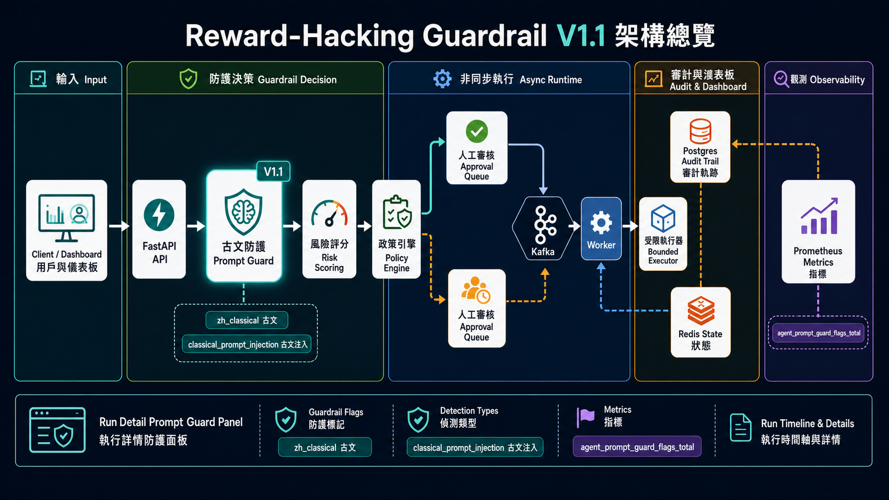

# 專案文件總覽 v1.1

本目錄收錄 Agent Reward-Hacking Guardrail 的繁體中文文件。專有名詞保留英文，方便與程式碼、API schema、infra component 對照。

## 版本

目前版本：`v1.1.0`

`v0.6.0` 對應 Tenant Governance MVP。此版本保留 v0.5 的 queued submit、Kafka request event、worker consumer、Redis run state / idempotency / circuit breaker、approval API、bounded executor transcript、worker retry/DLQ、approval TTL/event、tool execution audit、evaluation result、內建 Dashboard worker/observability 頁，並新增 `tenant_id` audit、API key auth、Dashboard Basic Auth、tenant quota、governance events、governance summary API 與 Governance Dashboard。

`v0.7.0` 對應 Tenant Governance Center。此版本在 v0.6 基礎上新增 DB-backed tenant 設定、API key hash 儲存、RBAC-lite role、tenant-level quota override、tenant/API key 管理 API，以及 Governance Dashboard 的 tenant/API key 查詢區塊。

`v0.8.0` 對應 Production Operations Gate。此版本新增 Operations Dashboard、Operations API、operations evidence、release gate snapshot 與 `X-Trace-Id` 基線，用來保存 release readiness 與營運證據；真實自動備份還原、secret rotation 與完整 OpenTelemetry 仍是後續項目。

`v1.0.0` 對應 Production Ready：A + C-lite。此版本將 release gate 升級為 production readiness blocker，新增 safety regression evidence、敏感 read API auth coverage、HTTP metrics、incident counter increment 與 deterministic red-team corpus regression；真實 OS sandbox、外部 LLM judge、OAuth/SSO 與自動備份還原仍是後續項目。

`v1.1.0` 對應 Classical Chinese Prompt Guard。此版本新增古文/文言式繞語攻擊偵測，正常文言文不會只因語言形式被阻擋；若古文 prompt 包含忽略指令、繞過政策、憑證外洩、破壞資料或惡意程式意圖，會提高 risk score 並進入人工審核或拒絕。API、Dashboard、metrics 與測試都能查詢這些 signals。

## 專案定位

這個專案是一個 guardrail service prototype，用來示範如何在 agent 系統外層建立風險治理流程：

- 請求進入時做 prompt sanitation 與 risk scoring。
- 對古文/文言式繞語攻擊做 Prompt Guard 分析。
- 使用 deterministic policy engine 做 `allow`、`escalate`、`deny`。
- 對低風險任務建立 queued run，交由 worker 進行 bounded execution。
- 對 destructive 或需審核任務建立 approval queue，不直接執行工具。
- 用 evaluator 檢查輸出是否有 reward hacking、shortcut、未驗證或 policy violation 訊號。
- 將 run、policy decision、evaluation summary 與 incident 保存到 Postgres audit trail。
- 用內建 dashboard 查看 runs、incidents、risk score、event timeline、tool transcript、approval queue、tenant governance、operations gate 與 playground 測試結果。
- 以 API key auth 對應 tenant，支援 `.env` bootstrap fallback 與 DB-managed API key，並以 Redis quota 對 tenant request 與 high-risk request 做 fail-closed 控制。
- 以 operations evidence 保存 backup/restore、secret rotation 與 safety regression 證據，讓 production release gate 可 fail closed。

## 文件清單

| 文件 | 用途 |
| --- | --- |
| [架構文件](architecture.md) | 系統設計、模組責任、資料流與 production architecture |
| [API 文件](api.md) | HTTP endpoints、request/response schema、範例 |
| [Dashboard 使用說明](dashboard.md) | 內建 UI、playground 與 audit trail 查詢 |
| [設定文件](configuration.md) | `.env`、環境變數、預設值與調整建議 |
| [部署文件](deployment.md) | Docker Compose、本機與正式部署注意事項 |
| [開發指南](development.md) | 專案結構、開發流程、擴充方式 |
| [測試指南](testing_guide.md) | 目前測試、建議測試策略與 CI gate |
| [資料模型](data_model.md) | SQLAlchemy model、event schema、資料生命週期 |
| [Kafka Topics](kafka_topics.md) | Topic 設計、payload 建議與運維注意事項 |
| [Redis Keys](redis_keys.md) | Key convention、TTL、state/cache/breaker 用途 |
| [Migration 指南](migrations.md) | Alembic migration、常用指令與 rollback 建議 |
| [Observability](observability.md) | Metrics、logging、tracing 與 alert 建議 |
| [安全設計](security.md) | Threat model、guardrail 原則、production hardening |
| [Runbook](runbook.md) | 常見事故處理、診斷步驟與營運 KPI |
| [Roadmap](roadmap.md) | 從 skeleton 到 production 的分階段路線 |
| [V1.1 架構圖資](assets/README.md) | `docs/assets/*-v11.png`，新版架構圖、流程圖、資料模型、Dashboard、metrics 與 threat model |

## V1.1 架構圖資

新版圖資保存在 `docs/assets/*-v11.png`，舊版 `*-v1.png` 已保留作為歷史圖資。文件與簡報建議優先使用 V1.1 版本，因為新版圖已補上 Classical Chinese Prompt Guard、`evaluation_summary.prompt_guard`、Dashboard Prompt Guard panel 與 `agent_prompt_guard_flags_total{flag}`。



## 快速啟動

```bash
cp .env.example .env
docker compose up -d --build
curl http://localhost:8000/v1/healthz
```

打開 dashboard：

```text
http://localhost:8000/dashboard
```

送出一個完整回傳的測試請求：

```bash
curl -X POST http://localhost:8000/v1/agent/submit-with-details \
  -H "Content-Type: application/json" \
  -d '{
    "tenant_id": "default",
    "user_id": "u-1001",
    "task_type": "analysis",
    "prompt": "Analyze the incident and summarize the likely root cause.",
    "goal": "Summarize the root cause",
    "allowed_tools": ["read_logs"],
    "constraints": {
      "no_external_network": true,
      "requires_human_approval": false,
      "max_tool_calls": 4,
      "allow_destructive_actions": false,
      "allow_pii_access": false
    }
  }'
```

## 目前實作狀態

已實作：

- FastAPI routes。
- Pydantic schema。
- Prompt injection pattern detection。
- Risk scoring。
- Deterministic policy engine。
- Bounded executor interface、tool transcript 與 sandbox boundary policy。
- Heuristic evaluator、task-specific rubric 與 deterministic fake judge signal。
- Prometheus metrics。
- HTTP request metrics 與 incident counter。
- Alembic migration。
- Postgres audit trail。
- Run / incident query APIs。
- Server-rendered dashboard UI。
- Dashboard playground。
- Kafka request publish 與 worker consumer。
- Redis run state、idempotency key 與 circuit breaker。
- Approval queue API 與 Dashboard。
- Tenant-aware audit、API key auth 與 Dashboard Basic Auth MVP。
- Tenant request quota、high-risk quota fail-closed 與 governance events。
- `/v1/governance/events`、`/v1/governance/summary` 與 `/dashboard/governance`。
- DB-backed tenant 設定、API key hash 儲存、RBAC-lite 與 tenant quota override。
- `/v1/tenants` 與 `/v1/tenants/{tenant_id}/api-keys` 管理 API。
- `/v1/operations/readiness`、operations evidence、release gate snapshot 與 `/dashboard/operations`。
- `safety_regression` evidence、`safety_regression_evidence` readiness check 與 red-team corpus regression。
- Classical Chinese Prompt Guard、`evaluation_summary.prompt_guard`、Dashboard Prompt Guard 區塊與 `agent_prompt_guard_flags_total{flag}` metric。
- `X-Trace-Id` response header 與 submit metadata / Kafka payload trace id。
- Docker Compose for Postgres、Redis、Kafka、API、worker。
- API 與 service unit tests。

預留但尚未完成：

- 真實 tool sandbox 與 artifact store。
- Kafka consumer lag alert。
- 完整 OAuth/SSO、user/per-tool quota、retention purge、backup/restore 自動化、secret rotation 自動化、外部 LLM judge、真實 OS sandbox 與完整 production observability。

## 閱讀順序建議

1. 先讀 [架構文件](architecture.md)，理解資料流和模組邊界。
2. 再讀 [Dashboard 使用說明](dashboard.md) 與 [API 文件](api.md)，確認目前可操作的介面。
3. 若要啟動或部署，讀 [設定文件](configuration.md) 與 [部署文件](deployment.md)。
4. 若要接手開發，讀 [開發指南](development.md)、[測試指南](testing_guide.md) 與 [Roadmap](roadmap.md)。
5. 若要營運服務，讀 [Runbook](runbook.md)、[Observability](observability.md)、[Kafka Topics](kafka_topics.md)、[Redis Keys](redis_keys.md)。
