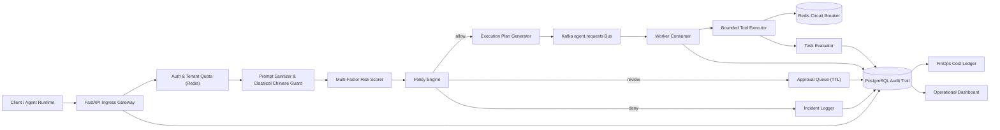

# System Architecture

> **Architecture Version**: `v1.5.2`  
> **Previous Versions**: `v1.5.1`, `v1.5.0`, `v1.4.0`

This document details the system topology, component responsibilities, and request dataflow of the **RewardHacking Guardrail** platform.

---

## Architectural Evolution

- **`v1.5.2` (Current)**: Open-Source Baseline. Unified documentation in English, standardized community templates, automated secret checks, and operations gate synchronization.
- **`v1.5.1` (Historical)**: Added official model pricing catalog seed ingestion, dry-run evaluation, versioned pricing change logs, and Admin FinOps pricing dashboard.
- **`v1.5.0` (Historical)**: Introduced Agent FinOps Core / Cost Ledger (`pricing_catalog`, `usage_events`, `cost_events`, `budget_policies`, `budget_violations`).
- **`v1.4.0` (Historical)**: Added Checkpoint / Resume / Replay MVP, enabling submit checkpoints, resume checkpoints, and dry-run replay attempts.
- **`v1.3.0` (Historical)**: Implemented Trace & Replay Readiness, propagating `X-Trace-Id` to execution plans, step audits, and replay bundles.
- **`v1.2.0` (Historical)**: Introduced Control Plane Execution Plan, tool definitions, and workflow registries.
- **`v1.1.0` (Historical)**: Added Classical Chinese Prompt Guard for adversarial literary/classical Chinese jailbreak detection.
- **`v1.0.0` (Historical)**: Established production operations gate with safety regression verification and red-team regression suites.
- **`v0.6.0` - `v0.8.0` (Historical)**: Tenant Governance Center, hashed API keys, Redis quotas, and operations evidence logging.
- **`v0.1.0` - `v0.5.0` (Historical)**: Core guarded asynchronous execution, Kafka worker queues, retry/DLQ, Redis run states, human approval TTL gates, and evaluator transcripts.

---

## Component Topology

---

## Component Responsibilities

### 1. Ingress API Gateway (`app/api/`)
- Accepts structured agent execution requests via `POST /v1/agent/submit` and `POST /v1/agent/submit-with-details`.
- Validates request payloads against Pydantic schemas.
- Assigns or propagates the distributed trace identifier (`X-Trace-Id`).
- Checks tenant API key validity and enforces per-tenant rate limits via Redis.

### 2. Prompt Sanitizer & Classical Chinese Guard (`app/services/prompt_sanitizer.py`)
- Analyzes prompts for direct jailbreaks (`ignore previous instructions`, `bypass policy`, `reveal system prompt`).
- Conducts specialized detection against **Classical Chinese Prompt Injection** (archaic idioms, obscure obfuscations, credential harvesting disguised in classical poetry).
- Generates structured prompt flags attached to `evaluation_summary.prompt_guard`.

### 3. Risk Scorer & Policy Engine (`app/services/risk_scoring.py`, `app/services/policy_engine.py`)
- Computes deterministic risk scores (0.0 to 1.0) based on task category, requested tool permissions, external network flags, and prompt signals.
- Classifies requests into:
  - `allow`: Low-risk requests routed directly to execution planning.
  - `escalated`: High-risk or destructive actions diverted into the human approval queue (`awaiting_approval`).
  - `denied`: Prohibited actions blocked immediately, triggering an incident record.

### 4. Control Plane Execution Planning (`app/services/control_plane.py`)
- Generates pre-execution execution plans capturing workflow version, planned steps, selected tools, and policy snapshots before queuing.
- Records step-level audits linked to the shared trace identifier.

### 5. Event Bus & Asynchronous Worker (`app/workers/`)
- Uses Kafka topic `agent.requests` to decouple API ingress from long-running agent tool invocations.
- Background worker consumes queued runs, reconstructs the execution context, re-verifies policies, and executes bounded tools.
- Implements exponential backoff retries and Dead Letter Queue (DLQ) routing for exhausted attempts.

### 6. Bounded Tool Executor & Circuit Breakers (`app/services/tool_executor.py`)
- Enforces strict constraints on tool invocation count (`max_tool_calls`), timeout limits, and permitted tool lists.
- Tracks tool failure frequencies in Redis; trips circuit breakers if consecutive failures exceed thresholds.
- Simulates tool execution safely during dry-run and test modes without invoking external side-effects.

### 7. Task Evaluator (`app/services/evaluator.py`)
- Evaluates agent outputs against rubrics (shortcut detection, unverified completion claims, policy adherence).
- Emits structured evaluation verdicts recorded in PostgreSQL.

### 8. Agent FinOps Core & Cost Accounting (`app/services/finops.py`)
- Maintains an official model pricing catalog with tiered token pricing, tool fees, and worker runtime rates.
- Ingests deterministic `usage_events` and calculates immutable `cost_events` per run, workflow, and tenant.
- Evaluates run-level budget policies and generates budget violation alerts.

### 9. Operational Dashboard (`app/ui/`)
- Server-rendered HTML dashboard providing operational visibility:
  - Overview metrics, recent runs, and active incidents.
  - Interactive human approval queue with decision submission.
  - Control plane execution plans, replay bundles, and trace inspection.
  - Tenant governance settings, API keys, and quota overrides.
  - Operations release gate checklist and deployment evidence.
  - FinOps cost summaries and pricing catalog management.
