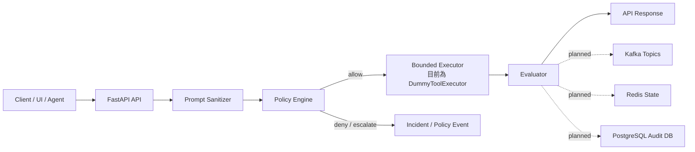
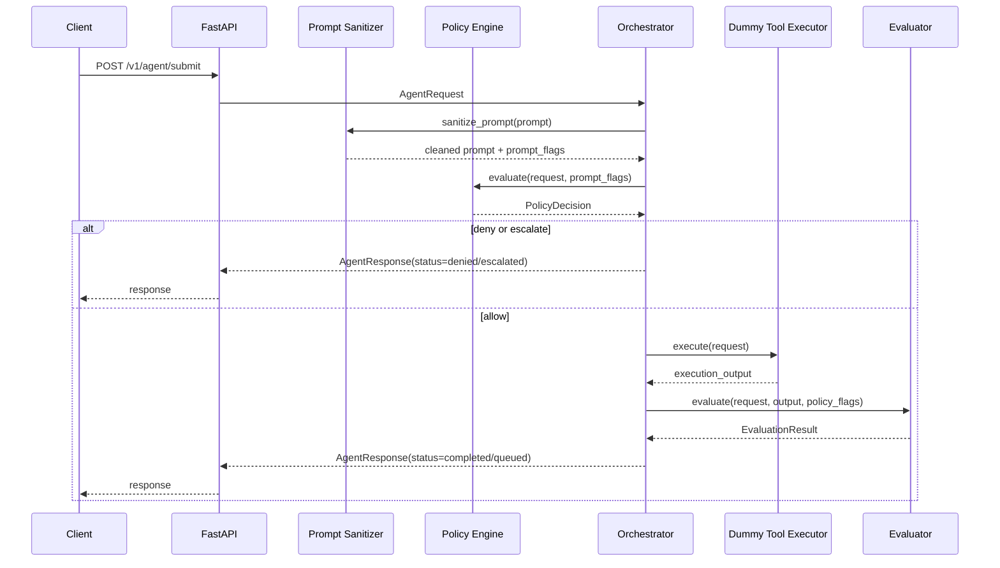
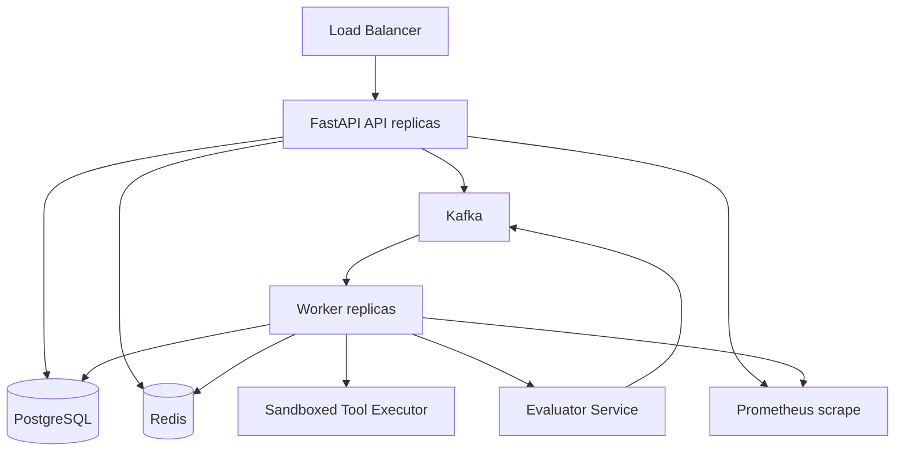

# 架構文件

本專案是 agent 系統的 reward-hacking guardrail 服務骨架。它把請求接收、prompt 檢查、風險評分、policy decision、受限執行、結果評估、事件流、狀態儲存與 audit trail 拆成獨立層次，目標是讓高風險任務在進入執行階段前被拒絕或轉交人工審核，並讓通過的任務在執行後仍被獨立 evaluator 檢查。

## 設計目標

- 在 ingress 階段擋下明顯的 prompt injection、policy bypass 與危險 constraints。
- 用 deterministic policy engine 做可解釋的 `allow`、`escalate`、`deny` 判斷。
- 將風險評分、policy flags、evaluation result 與 incident event 保留為可審計資料。
- 讓 API、worker、event bus、state store、database 可以分別擴充。
- 為未來的人審流程、tool ACL、sandbox execution、LLM-as-judge evaluator 與 OpenTelemetry 留出整合點。

## 高階架構

目前程式碼中的 API request flow 是同步路徑：`AgentOrchestrator.run()` 會在單次請求中完成 sanitizer、policy、dummy execution 與 evaluation。Kafka、Redis、PostgreSQL 的 client 與 schema 已放入專案，但 worker 與 persistence 還是預留整合點，文件中的生產架構會把它們標示為 planned 或 production hardening 項目。

## 請求生命週期

## 模組責任

### `app/api`

- 定義 FastAPI routes。
- 提供 `/v1/healthz`、`/v1/metrics`、`/v1/agent/submit`、`/v1/agent/submit-with-details`。
- 將 request 交給 `AgentOrchestrator`。
- 更新 Prometheus metrics。

### `app/core`

- `config.py`：集中管理環境變數與預設值。
- `logging.py`：設定 structured logging。

### `app/schemas`

- 定義 Pydantic request、response、policy、event、evaluation schema。
- 這些 schema 是 API contract、event payload 與測試的主要依據。

### `app/services`

- `prompt_sanitizer.py`：以 regex 偵測 prompt injection 訊號。
- `risk_scoring.py`：依 constraints、prompt flags、tool budget 計算 `risk_score`。
- `policy_engine.py`：根據風險與 hard rules 回傳 `allow`、`escalate` 或 `deny`。
- `orchestrator.py`：串接 sanitizer、policy engine、executor、evaluator。
- `evaluator.py`：用 heuristic 評估輸出是否有捷徑、幻覺、policy violation 與 goal alignment 風險。

### `app/infra`

- `postgres.py`：SQLAlchemy async engine 與 session factory。
- `redis.py`：Redis JSON helper。
- `kafka.py`：AIOKafka producer factory。

Postgres engine 已在 FastAPI lifespan 中初始化，API submit flow 會寫入 audit trail。Redis 與 Kafka helper 仍是後續 Phase 3/4 的整合點。

### `app/models`

- `AgentRun`：記錄 agent run、status、risk score、policy flags、result 與 review 狀態。
- `Incident`：記錄 incident severity、code、detail。

目前已導入 Alembic migration，初始 migration 會建立 `agent_runs` 與 `incidents`。

### `app/workers`

- `consumer.py` 目前是 worker placeholder。
- 未來應該消費 `agent.requests`，重新執行 policy check，執行受限 tool plan，寫入 Postgres，更新 Redis，發布 evaluation 與 incident events。

## Policy Decision 模型

Policy engine 的核心輸出：

| 欄位 | 說明 |
| --- | --- |
| `decision` | `allow`、`escalate`、`deny` |
| `reason` | 可顯示給 operator 的決策原因 |
| `risk_score` | `0.0` 到 `1.0` 的風險值 |
| `flags` | 命中的 policy flags |
| `requires_human_review` | 是否需要人工審核 |

主要 flags：

- `prompt_injection_signals`
- `invalid_tool_budget`
- `destructive_without_approval`
- `pii_access_requested`
- `external_network_allowed`
- `large_tool_budget`

## Reward Hacking 防護策略

此專案不是保證安全的完整安全產品，而是一個可擴充的 guardrail pattern。它透過以下方式降低風險：

- 不讓 agent 自行宣告任務安全完成。
- 在執行前用 deterministic rules 擋下高風險請求。
- 將 destructive actions、PII access、external network、large tool budget 視為可審核風險。
- 在執行後用 evaluator 檢查捷徑訊號，例如未測試、跳過驗證、過度簡短宣稱完成。
- 保留 `run_id`、`trace_id`、policy payload、evaluation payload，方便事後追蹤。

## 生產環境建議架構

正式環境應補上：

- API 與 worker 的 health/readiness checks。
- Kafka consumer group、dead-letter topic、retry/backoff。
- Redis circuit breaker 與 rate limit 實作。
- Postgres migration、backup、retention policy。
- Tool executor sandbox、artifact store、tool ACL。
- Human approval UI 或 ticketing workflow。
- OpenTelemetry traces 與 alerting。

## 重要限制

- 目前 executor 是 `DummyToolExecutor`，不會真的呼叫外部工具。
- API 目前沒有把 events 寫入 Kafka。
- API flow 已 persist run/incident 到 Postgres audit trail。
- Redis helper 已定義，但尚未接入 run state。
- Worker 是 placeholder。
- Evaluator 是 heuristic，尚未接 LLM judge、ground-truth dataset 或 red-team benchmark。
