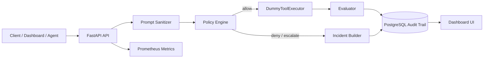
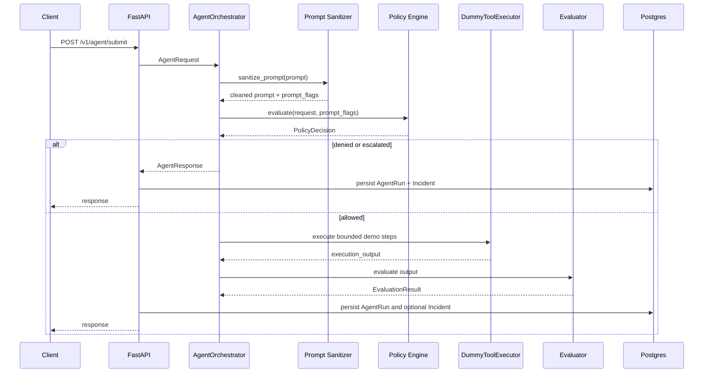

# 架構文件 v0.2

本專案目前是 Agent Reward-Hacking Guardrail 的可展示 prototype。核心流程是同步 FastAPI API：接收 agent request、進行 prompt sanitation、risk scoring、policy decision、demo bounded execution、evaluation，最後把 run 與 incident 寫入 Postgres audit trail，並透過內建 Dashboard 呈現。

目前架構版本：`v0.2.0`

## 目前架構

目前已接入：

- FastAPI JSON API。
- Server-rendered Dashboard UI。
- Postgres audit trail。
- Alembic migration。
- Prometheus metrics。
- Structured logging。

目前尚未接入執行流程：

- Kafka event publishing / worker consumer。
- Redis run state / circuit breaker。
- 真實 tool executor / sandbox。
- Human approval workflow。

## Request Flow

## 模組責任

### `app/api`

- 提供 `/v1/healthz`、`/v1/readyz`、`/v1/metrics`。
- 提供 agent submit endpoints。
- 提供 run、incident、dashboard summary 查詢 endpoints。
- 將 submit 結果寫入 Postgres audit trail。

### `app/ui`

- 提供內建 Dashboard：
  - `/dashboard`
  - `/dashboard/runs`
  - `/dashboard/runs/{run_id}`
  - `/dashboard/playground`
- UI 使用 Jinja2 template，不需要獨立前端 build chain。

### `app/services`

- `prompt_sanitizer.py`：偵測 prompt injection 訊號。
- `risk_scoring.py`：計算 risk score。
- `policy_engine.py`：產生 `allow`、`escalate`、`deny` decision。
- `orchestrator.py`：串接 sanitizer、policy、executor、evaluator。
- `evaluator.py`：以 heuristic 評估 shortcut、hallucination、policy violation。
- `audit_log.py`：封裝 run/incident persistence 與 dashboard summary 查詢。

### `app/infra`

- `postgres.py`：FastAPI lifespan 會初始化 SQLAlchemy async engine 與 session factory。
- `kafka.py`：AIOKafka producer factory，保留給 Phase 3。
- `redis.py`：Redis JSON helper，保留給 Phase 4。

### `app/models`

- `AgentRun`：保存 request、status、risk score、policy flags、execution output、evaluation summary。
- `Incident`：保存 policy/evaluation 產生的事件。

### `app/workers`

`consumer.py` 目前仍是 placeholder。Phase 3 才會導入 Kafka consumer、retry、DLQ 與 async execution。

## API Surface

目前主要 API：

- `GET /v1/healthz`
- `GET /v1/readyz`
- `GET /v1/metrics`
- `POST /v1/agent/submit`
- `POST /v1/agent/submit-with-details`
- `GET /v1/runs`
- `GET /v1/runs/{run_id}`
- `GET /v1/runs/{run_id}/incidents`
- `GET /v1/incidents`
- `GET /v1/dashboard/summary`

## Production Extension Points

- Kafka worker：將 API ingestion 與 execution 解耦。
- Redis state：run state、approval token、rate limit、circuit breaker。
- Tool sandbox：替換 `DummyToolExecutor`。
- Human approval：讓 `escalated` 成為可處理 workflow。
- LLM-as-judge evaluator：作為 evaluator signal，不作為唯一 hard deny。
- OpenTelemetry：補 traces 與跨 component correlation。

## 重要限制

- `DummyToolExecutor` 不會真的呼叫外部工具。
- API 目前不 publish events 到 Kafka。
- Redis helper 尚未接入 run state。
- Worker 尚未實作。
- Dashboard 尚未加入登入權限，不應直接暴露在公開網路。
