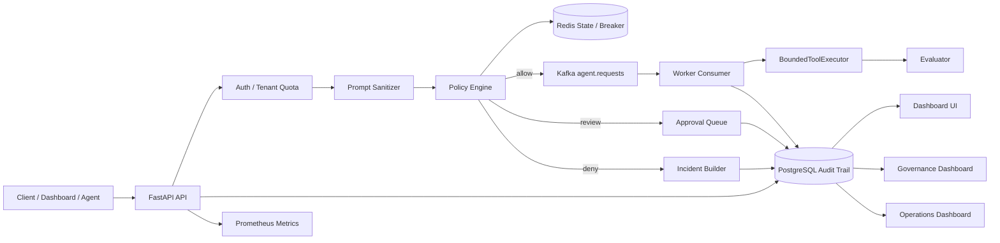
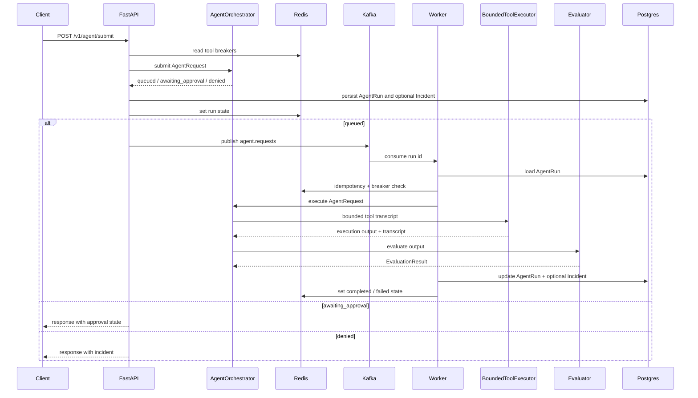

# 架構文件 v1.0

本專案目前是 Agent Reward-Hacking Guardrail 的 guarded async execution hardening 版本。核心流程是 FastAPI API 接收 agent request、進行 prompt sanitation、risk scoring 與 policy decision；低風險任務寫入 Postgres audit trail、標記為 `queued`，並 publish Kafka request event；worker 重新讀取 run、重跑 policy、執行 bounded executor、evaluate 結果並寫回 audit trail。高風險或 destructive 任務會進入 `awaiting_approval`，由 Dashboard 或 API 進行審核。

目前架構版本：`v1.0.0`

## 目前架構

目前已接入：

- FastAPI JSON API。
- Server-rendered Dashboard UI。
- Postgres audit trail。
- Alembic migration。
- Kafka request publish 與 worker consumer。
- Redis run state、idempotency key、tool circuit breaker。
- Bounded executor interface、tool transcript、artifact refs。
- Approval queue API 與 Dashboard。
- Worker attempts、retry/backoff 與 DLQ audit。
- Approval TTL、reviewer、decision reason 與 approval event。
- Tool execution audit table。
- Task-specific evaluator result table。
- Prometheus metrics。
- Structured logging。
- API key auth 與 Dashboard Basic Auth MVP。
- Tenant-aware audit trail、Redis tenant quota 與 governance event 查詢。
- DB-backed tenant 設定、API key hash 儲存、RBAC-lite 與 tenant quota override。
- Operations evidence、safety regression evidence、release gate snapshot、release readiness checks 與 `X-Trace-Id` response header。
- 敏感 read API 的 API key auth coverage、HTTP request metrics 與 incident counter。

目前尚未完整接入：

- 真實 OS sandbox 執行器；目前是 sandbox boundary audit contract。
- 完整 OAuth/RBAC、tenant 管理 UI、Kafka lag alert、完整 OpenTelemetry 與 production SLO enforcement。
- 自動 retention purge、真實 backup/restore 自動化與 secret rotation 自動化。

## Request Flow

## 模組責任

### `app/api`

- 提供 `/v1/healthz`、`/v1/readyz`、`/v1/metrics`。
- 提供 agent submit endpoints。
- 提供 run、incident、approval、dashboard summary 查詢 endpoints。
- submit 時讀取 Redis breaker、寫入 Postgres audit trail，並在 queued 時 publish Kafka event。
- submit 時會解析 tenant、檢查 quota，必要時寫入 governance event。

### `app/ui`

- 提供內建 Dashboard：
  - `/dashboard`
  - `/dashboard/runs`
  - `/dashboard/runs/{run_id}`
  - `/dashboard/approvals`
  - `/dashboard/worker`
  - `/dashboard/observability`
  - `/dashboard/governance`
  - `/dashboard/operations`
  - `/dashboard/playground`
- UI 使用 Jinja2 template，不需要獨立前端 build chain。

### `app/services`

- `prompt_sanitizer.py`：偵測 prompt injection 訊號。
- `risk_scoring.py`：計算 risk score。
- `policy_engine.py`：產生 `allow`、`escalate`、`deny` decision，並接收 disabled tools 作為 circuit breaker signal。
- `orchestrator.py`：負責 submit / execute 兩段流程，串接 sanitizer、policy、executor、evaluator。
- `executor.py`：bounded executor interface，記錄 tool transcript 與 artifact refs。
- `run_state.py`：Redis 與 in-memory state store，管理 run state、idempotency、breaker。
- `auth.py`：解析 `X-API-Key` 與 tenant 對應，提供最小 auth context。
- `quota.py`：使用 state store 做 tenant request quota 與 high-risk quota 檢查；v0.7 可由 tenant DB 設定覆蓋全域預設。
- `events.py`：Kafka 與 in-memory event publisher。
- `evaluator.py`：以 heuristic 評估 shortcut、hallucination、policy violation。
- `operations.py`：計算 release readiness、保存 operations/safety regression evidence 與 release gate snapshot。
- `audit_log.py`：封裝 run/incident persistence、approval decision 與 dashboard summary 查詢。

### `app/infra`

- `postgres.py`：FastAPI lifespan 與 worker 會初始化 SQLAlchemy async engine 與 session factory。
- `kafka.py`：AIOKafka producer factory。
- `redis.py`：Redis JSON helper。

### `app/models`

- `AgentRun`：保存 request、status、risk score、policy flags、execution output、evaluation summary。
- `Incident`：保存 policy/evaluation/approval/worker 產生的事件。
- `GovernanceEvent`：保存 quota hit 與 high-risk quota fail-closed 等治理事件。
- `Tenant`：保存 tenant 名稱、狀態與 tenant-level quota。
- `TenantApiKey`：保存 API key hash、prefix、role、status 與撤銷狀態。
- `OperationsEvidence`：保存 backup/restore、secret rotation、safety regression 等人工營運證據。
- `ReleaseGateRun` / `ReleaseGateItem`：保存 release gate snapshot 與每個檢查項目。

### `app/workers`

- `producer.py`：建立 Kafka event envelope。
- `consumer.py`：消費 `agent.requests`，依 run id 處理 queued run，寫回 Postgres 與 Redis。

## API Surface

目前主要 API：

- `GET /v1/healthz`
- `GET /v1/readyz`
- `GET /v1/metrics`
- `POST /v1/agent/submit`
- `POST /v1/agent/submit-with-details`
- `GET /v1/runs`
- `GET /v1/runs/{run_id}`
- `GET /v1/runs/{run_id}/incidents`
- `GET /v1/incidents`
- `GET /v1/approvals`
- `POST /v1/approvals/{run_id}/decision`
- `GET /v1/runs/{run_id}/worker-attempts`
- `GET /v1/runs/{run_id}/tool-executions`
- `GET /v1/worker/dlq`
- `GET /v1/evaluations`
- `GET /v1/observability/summary`
- `GET /v1/governance/events`
- `GET /v1/governance/summary`
- `GET /v1/dashboard/summary`
- `GET /v1/tenants`
- `POST /v1/tenants`
- `PATCH /v1/tenants/{tenant_id}`
- `GET /v1/tenants/{tenant_id}/api-keys`
- `POST /v1/tenants/{tenant_id}/api-keys`
- `POST /v1/tenants/{tenant_id}/api-keys/{key_id}/revoke`
- `GET /v1/operations/readiness`
- `POST /v1/operations/evidence`
- `GET /v1/operations/evidence`
- `POST /v1/operations/release-gates`
- `GET /v1/operations/release-gates`
- `GET /v1/operations/release-gates/{gate_id}`

## Production Extension Points

- Tool sandbox：把目前 audit contract 演進成真實 OS/process/network/filesystem sandbox。
- LLM-as-judge evaluator：接入外部模型，但維持 signal-only，不作為唯一 hard deny。
- OpenTelemetry：目前只有 `X-Trace-Id` 基線，後續補完整 span 與跨 component correlation。
- 完整 OAuth/RBAC、tenant 管理 UI、retention purge、backup/restore automation。

## 重要限制

- `BoundedToolExecutor` 目前不會真的呼叫外部工具，只記錄受控 tool transcript。
- Kafka worker 已接入 retry/backoff 與 DLQ audit，但尚未包含 consumer lag alert。
- Redis 是短期 state 與 breaker，不是唯一 audit store。
- Approval workflow 已有 TTL、reviewer、request changes 與 event audit；多 reviewer queue 與權限控管放到後續版本。
- Dashboard 已有可選 Basic Auth MVP；正式公開前仍應接入更完整的 SSO/RBAC 或反向代理保護。
- Operations Gate 保存 readiness 與人工 evidence，不會自動執行真實備份、還原、purge、safety regression 或 secret rotation。
