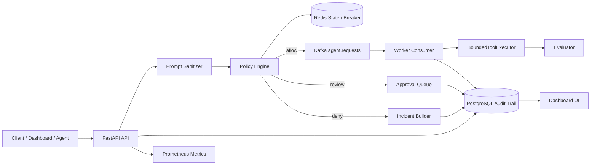
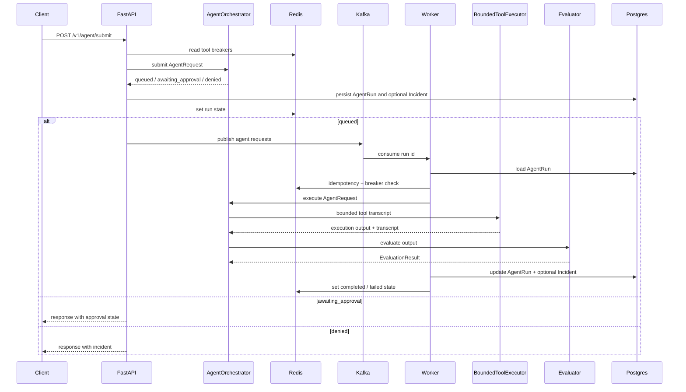

# 架構文件 v0.3

本專案目前是 Agent Reward-Hacking Guardrail 的 guarded async execution MVP。核心流程是 FastAPI API 接收 agent request、進行 prompt sanitation、risk scoring 與 policy decision；低風險任務寫入 Postgres audit trail、標記為 `queued`，並 publish Kafka request event；worker 重新讀取 run、重跑 policy、執行 bounded executor、evaluate 結果並寫回 audit trail。高風險或 destructive 任務會進入 `awaiting_approval`，由 Dashboard 或 API 進行審核。

目前架構版本：`v0.3.0`

## 目前架構

目前已接入：

- FastAPI JSON API。
- Server-rendered Dashboard UI。
- Postgres audit trail。
- Alembic migration。
- Kafka request publish 與 worker consumer。
- Redis run state、idempotency key、tool circuit breaker。
- Bounded executor interface、tool transcript、artifact refs。
- Approval queue API 與 Dashboard。
- Prometheus metrics。
- Structured logging。

目前尚未完整接入：

- Worker retry/backoff 與 DLQ。
- 完整 OS sandbox、network/filesystem/process/secret 邊界。
- 完整 approval workflow，例如 TTL、reviewer 報表與 request changes 後續流程。
- Auth、tenant isolation、OpenTelemetry 與 production SLO。

## Request Flow

## 模組責任

### `app/api`

- 提供 `/v1/healthz`、`/v1/readyz`、`/v1/metrics`。
- 提供 agent submit endpoints。
- 提供 run、incident、approval、dashboard summary 查詢 endpoints。
- submit 時讀取 Redis breaker、寫入 Postgres audit trail，並在 queued 時 publish Kafka event。

### `app/ui`

- 提供內建 Dashboard：
  - `/dashboard`
  - `/dashboard/runs`
  - `/dashboard/runs/{run_id}`
  - `/dashboard/approvals`
  - `/dashboard/playground`
- UI 使用 Jinja2 template，不需要獨立前端 build chain。

### `app/services`

- `prompt_sanitizer.py`：偵測 prompt injection 訊號。
- `risk_scoring.py`：計算 risk score。
- `policy_engine.py`：產生 `allow`、`escalate`、`deny` decision，並接收 disabled tools 作為 circuit breaker signal。
- `orchestrator.py`：負責 submit / execute 兩段流程，串接 sanitizer、policy、executor、evaluator。
- `executor.py`：bounded executor interface，記錄 tool transcript 與 artifact refs。
- `run_state.py`：Redis 與 in-memory state store，管理 run state、idempotency、breaker。
- `events.py`：Kafka 與 in-memory event publisher。
- `evaluator.py`：以 heuristic 評估 shortcut、hallucination、policy violation。
- `audit_log.py`：封裝 run/incident persistence、approval decision 與 dashboard summary 查詢。

### `app/infra`

- `postgres.py`：FastAPI lifespan 與 worker 會初始化 SQLAlchemy async engine 與 session factory。
- `kafka.py`：AIOKafka producer factory。
- `redis.py`：Redis JSON helper。

### `app/models`

- `AgentRun`：保存 request、status、risk score、policy flags、execution output、evaluation summary。
- `Incident`：保存 policy/evaluation/approval/worker 產生的事件。

### `app/workers`

- `producer.py`：建立 Kafka event envelope。
- `consumer.py`：消費 `agent.requests`，依 run id 處理 queued run，寫回 Postgres 與 Redis。

## API Surface

目前主要 API：

- `GET /v1/healthz`
- `GET /v1/readyz`
- `GET /v1/metrics`
- `POST /v1/agent/submit`
- `POST /v1/agent/submit-with-details`
- `GET /v1/runs`
- `GET /v1/runs/{run_id}`
- `GET /v1/runs/{run_id}/incidents`
- `GET /v1/incidents`
- `GET /v1/approvals`
- `POST /v1/approvals/{run_id}/decision`
- `GET /v1/dashboard/summary`

## Production Extension Points

- Worker retry/backoff 與 DLQ。
- Tool sandbox：強化 bounded executor，限制 network、filesystem、process、secret。
- Human approval：補 TTL、reviewer 報表、request changes 後續流程。
- LLM-as-judge evaluator：作為 evaluator signal，不作為唯一 hard deny。
- OpenTelemetry：補 traces 與跨 component correlation。
- Auth、tenant isolation、quota、retention、backup/restore。

## 重要限制

- `BoundedToolExecutor` 目前不會真的呼叫外部工具，只記錄受控 tool transcript。
- Kafka worker 已接入，但尚未包含 retry/backoff、DLQ 與 consumer lag alert。
- Redis 是短期 state 與 breaker，不是唯一 audit store。
- Approval workflow 是最小可用版，完整治理流程放到後續版本。
- Dashboard 尚未加入登入權限，不應直接暴露在公開網路。
