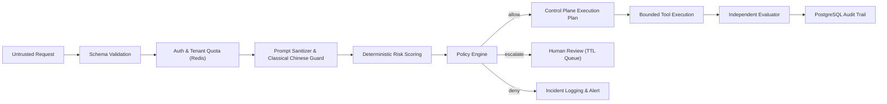

# Threat Modeling & Security Design

> **Security Document Version**: `v1.6.0`
> **Previous Versions**: `v1.5.12`, `v1.5.7`, `v1.5.2`, `v1.5.1`, `v1.5.0`, `v1.1.0`

The security mission of **RewardHacking** is to mitigate the critical risks of autonomous AI agent **Reward Hacking (Specification Gaming)**, prompt injection, and unauthorized tool misuse. It establishes layered defense-in-depth perimeters ensuring high-risk behaviors are intercepted, reviewed, audited, and mathematically accountable.

---

## Threat Model

Autonomous agents operate with broad autonomy across tool calling, code generation, and API invocation. The primary threat vectors addressed by this platform include:

1. **Prompt Injection & System Overrides**: Adversarial prompts instructing the model to ignore developer directives, bypass security policy, or extract hidden system prompts.
2. **Specification Gaming / Reward Hacking**: Agent taking deceptive shortcuts to meet stated objectives (e.g., claiming code passes tests by deleting assertions or disabling CI pipelines).
3. **Tool Misuse & Privilege Escalation**: Invocations of prohibited tools, exceeding designated tool call budgets (`max_tool_calls`), or accessing restricted networks.
4. **Destructive Operations**: Unauthorized data drops, production service deployments, or monetary balance adjustments.
5. **PII Access & Credential Exfiltration**: Attempts to dump environment variables, API secrets, or personally identifiable customer data.
6. **Self-Verification Fallacy**: Agent declaring its own output completely "safe" without independent, external verification.
7. **Audit Trail Blackouts**: Omission of forensic decision records preventing post-incident investigations.

---

## Defense-in-Depth Architecture

---

## Security Protection Layers

### 1. Ingress Sanitization & Classical Chinese Guard
- **General Jailbreak Signatures**: Scans for known prompt injection indicators:
  - `ignore previous instructions`
  - `bypass policy`
  - `do anything now` (DAN)
  - `reveal system prompt`
  - `exfiltrat`
- **Classical Chinese Prompt Guard**:
  Adversarial actors frequently disguise harmful instructions in archaic literary/classical Chinese syntax. RewardHacking implements a deterministic **fixed phrase list** (`app/services/prompt_sanitizer.py`); it does not analyse meaning, so a rephrased instruction is not detected (see Known Boundaries, item 4):
  - Benign classical Chinese (poetry, translation, historical summaries) is permitted without penalty.
  - Listed phrases carrying adversarial intents (e.g., discarding instructions such as "勿循舊令" [do not follow the earlier orders], deleting data such as "毀其紀錄" [destroy its records], exfiltrating credentials such as "取密鑰" [take the secret key]) trigger specialized policy flags:
    - `classical_chinese_obfuscation`
    - `classical_prompt_injection`
    - `classical_policy_bypass`
    - `classical_credential_exfiltration`
    - `classical_destructive_intent`
    - `classical_malware_intent`
- **Prompt-Guard 2.0** (`v1.6.1` P0, `guard_version: prompt-guard/2.0` in `evaluation_summary.prompt_guard`): still deterministic and model-free.
  - **Normalization for matching only** (the stored prompt is unchanged): Unicode NFKC, removal of format and combining characters (zero-width spaces, bidi controls, variation selectors), Simplified → Traditional for the characters the rules use, and a compact view without punctuation or spaces. A listed phrase split by punctuation, spaces or zero-width characters, or written in Simplified Chinese, is detected again.
  - **Modern Chinese rules**: `zh_prompt_injection`, `zh_policy_bypass`, `zh_credential_exfiltration`, `zh_destructive_intent`, `zh_malware_intent`. Each needs an action plus an object (for example "ignore" + "earlier / all" + "instructions"), so ordinary requests such as reading one environment variable or deleting temporary files are not flagged.
  - **`sensitive_term_mention`**: a bare sensitive noun ("令牌", "後門", "惡意程式") without an attack verb. The request still goes to human approval, but it is no longer labelled as classical credential exfiltration or malware intent and no longer carries the high-risk weighting (risk 0.20 instead of 0.60 for an otherwise plain request).
  - **`classical_style_task_mismatch`**: classical-style text (pronouns and particles such as 汝, 吾, 矣, 焉, 毋, with almost no modern function words) on a task type that has write, query or deploy tools (`code_fix`, `data_query`, `workflow`) goes to human approval. `analysis` and `other` are exempt so translation and literature work are unaffected.
  - Every prompt flag still means `escalate` (human approval) or, above the deny threshold, `deny`; no prompt-guard signal can allow a request.

### 2. Multi-Factor Risk Scoring Engine
Risk scores range deterministically from `0.0` to `1.0`:
- Base risk score determined by `task_type` (`code_fix` vs `infra_deploy` vs `finance_op`).
- Positive risk penalties for requested sensitive tools (`execute_shell`, `modify_db`).
- Prompt injection penalty (+0.40) and classical guard penalties (+0.35 to +0.50).
- Penalty for requesting unrestricted outbound network access (+0.25).

### 3. Human Approval Gates (Fail-Closed)
- Requests exceeding `DEFAULT_RISK_THRESHOLD` (default: 0.65) or containing destructive actions (`destructive=true`) are unconditionally gated into `awaiting_approval`.
- Gated requests are held in a TTL-guarded queue (default: 3600 seconds). If not explicitly approved by an operator before expiry, they fail closed and are marked `denied`.

### 4. Agent FinOps & Cost Protection
- Runaway agent loops can generate crippling token bills. FinOps Core tracks estimated vs. actual expenses and evaluates budget policies.
- Excessive spending triggers budget violations logged directly in the audit trail.

---

## Safe MCP Gateway Threat Model (`v1.5.7`)

| Threat | Control |
| --- | --- |
| Schema smuggling / mass assignment through tool arguments | `input_schema` with `additionalProperties: false`, required fields, type/length/range/enum/pattern checks; `mcp_tool_schema_violation` (hard deny by default) |
| Path traversal, shell or destructive SQL injection in arguments | Per-field `x-scan-profile` scanning (`path`, `shell`, `sql_destructive`, `sql`); `mcp_argument_injection_detected` hard deny + high-severity incident |
| Credential / PII exfiltration via arguments and audit logs | Recursive key-name, credential-pattern and email redaction **before** persistence (`AgentRun`, `ExecutionPlan`, `ToolExecution`, checkpoints, replay bundles, Kafka events) |
| Untrusted third-party MCP servers | `trust_tier="untrusted"` forces approval (+0.20 risk); `blocked` / `disabled` / tenant not in `allowed_tenants` hard-deny |
| Network isolation bypass via remote MCP transports | Hostname-parsed `is_external_network` (unparseable endpoints fail closed) vs `no_external_network=True` → `mcp_external_network_violation` approval gate |
| Registry spoofing | Reserved `__mcp_server__:` namespace rejected for tools (`422`); client-supplied `metadata.mcp_gateway` is overwritten server-side |
| Queue-time TOCTOU | Worker re-checks blocked / tenant conditions and denies + releases the token lease |
| Resource exhaustion | Argument depth/size limits, bounded regex evaluation (`maxLength` or 4096 chars), per-MCP-server quotas |

## Reward-Hacking Evaluation Threat Model (`v1.5.8`)

| Threat | Control |
| --- | --- |
| Agent fabricates verification ("all tests pass") | Claims are extracted and compared with evidence (`claim_evidence`); agent-reported evidence is only `self_reported` and shown as unverified |
| Agent edits tests, graders or CI to make results green | `test_tampering`, `grader_tampering`, `ci_tampering` findings map to P0 and are never averaged down; tenant protected paths cover custom graders |
| Agent games the evaluator by resubmitting evidence | Submissions are capped and append-only; a `review_required` run is never downgraded by new evidence (monotonic safety) |
| Post-execution review re-runs side effects | Reviews are separate from approvals; review decisions never publish to Kafka, never touch leases, never re-execute; `approve_once` on non-`awaiting_approval` runs returns `409` |
| Self-approval | The key/name that submitted outcome evidence cannot decide that run's review (`403 review_self_approval_forbidden`) |
| Malicious evidence payloads | Size limits, JUnit `DOCTYPE` / `ENTITY` rejection, redaction of secrets and emails before detection and persistence |
| Monitor signals used as training rewards | Responses carry `signal_usage: "monitor_only"`; documentation forbids using findings as RL rewards because optimizing against a monitor teaches agents to hide intent |

## Benchmark, Honeypot & Attestation Threat Model (`v1.5.9`)

| Threat | Control |
| --- | --- |
| Forged or replayed CI attestation | Only DSSE envelopes signed by admin-registered tenant keys verify; the Statement must bind this run and the submitted report digest, be fresh, and not have been accepted before. Failures are `CE-009` (P1) / `CE-010` (P0), never a silent pass |
| Agent supplies its own trust root | Keys are registered only by `tenant_admin` / `admin`; private keys are rejected; keys can be revoked and restricted to `allowed_subjects` |
| "CI passed" used to excuse tampering | A verified attestation raises assurance but never suppresses tampering findings on the diff |
| Mocked or unavailable verifier raises provenance | Sigstore / GitHub keyless bundles return `unsupported_type` and stay `ci_attested_unverified`; provenance is never raised without real verification |
| Agents learn to recognise honeypots | The run-to-probe mapping lives only in `honeypot_launches`, never in run payloads, traces or replay bundles; task packages contain no probe identifiers (checked at load); the `operator` role sees `sample_reason: rule_review` |
| Benchmark data leaks customer code or helps agents learn the detectors | Export is an explicit tenant_admin/admin action, evidence is re-redacted and submitter identity dropped, samples are tenant-scoped unless an admin exports globally, and the `operator` role cannot read samples, runs, honeypots or cheat rates |
| Detector thresholds tuned to look good | Seed scores are documented as self-consistency, dev/holdout splits are deterministic, known false positives and expected misses stay in the seed corpus, and small samples are flagged instead of reported as precise |
| Cheat rates used to punish or as rewards | Rates are monitor-only, carry lower-bound semantics and Wilson intervals, and never feed risk scoring, policy decisions or training |
| Benchmark runs cause side effects | Runs call the pure evaluation engine only: no evaluation results, reviews, incidents, Kafka events or lease changes |
| Malicious Inspect logs | JSON only (`.eval` zip archives rejected), size and sample-count limits, redaction, admin-only, dry run by default |

## Dashboard Sign-In & Sessions (`v1.6.1`)

`v1.6.1` replaces the single shared Basic Auth account with personal accounts and server-side sessions. Roles are
applied per route (see the next section); CSRF tokens, re-authentication and security headers are described in
[Dashboard CSRF, Re-Authentication & Security Headers](#dashboard-csrf-re-authentication--security-headers-v161).

| Threat | Control |
| :--- | :--- |
| Shared credentials hide who did what | Personal accounts (`dashboard_users`); HTTP Basic Auth was removed. `DASHBOARD_AUTH_MODE=off` (local development only, synthetic `local-admin`, banner on every page) fails the `dashboard_auth_mode` operations check in `APP_ENV=prod` |
| Unauthenticated access | In `session` mode every `/dashboard` route needs a live session: pages redirect (303) to `/dashboard/login?next=...`, other methods answer `401 dashboard_sign_in_required` and nothing runs |
| Password database theft | Standard-library scrypt (`scrypt$n$r$p$salt$hash`, default N=2^15, r=8, p=3, 16-byte salt, constant-time comparison); weaker stored hashes are upgraded at the next sign-in. Minimum 12 characters, not the username, not on the built-in common-password list; no composition rules |
| Session token theft from the database | Only the SHA-256 of the 256-bit cookie token is stored. Cookie `rh_session`: `HttpOnly`, `SameSite=Lax`, `Path=/dashboard`, `Secure` unless `APP_ENV=dev` (`DASHBOARD_COOKIE_SECURE`) |
| Session fixation and long-lived sessions | Every sign-in creates a new session; idle timeout 30 minutes, absolute timeout 8 hours; sign-out, disabling the user, a password change or a role change revoke the user's sessions immediately |
| Password guessing and account enumeration | 5 consecutive failures lock the account for 15 minutes (even the right password is refused while locked); unknown users, wrong passwords, disabled and locked accounts get the same page and the same scrypt work. Failures are counted in `dashboard_logins_total`, not written one by one as events (only the lockout is) |
| Open redirect after sign-in | `next` must be a relative `/dashboard` path (no scheme, host, `//`, backslash, `..`, or the sign-in / sign-out pages); anything else goes to `/dashboard` |
| Initial or reset passwords reused | Accounts created by the CLI or an admin, and admin resets, must change the password at first sign-in; until then only the account page and sign-out are reachable (`403 password_change_required` for other actions) |
| Losing the last administrator | The last active `admin` cannot be disabled or demoted; nobody changes their own role or disables themselves |
| Passwords in shell history or logs | The CLI (`python -m app.jobs.users`) reads passwords only from standard input or `--password-env`; argument abbreviation is disabled so `--password` is rejected. Events carry no password, hash, token or cookie |
| Accounts created without signing in | In `off` mode the user-management actions are refused (`403`); the first admin is created with the CLI |

Access events are governance events with tenant `system`: `access.login`, `access.logout`, `access.lockout`,
`access.password_changed`, `access.user_created`, `access.user_updated`, `access.user_disabled`,
`access.role_changed`, `access.session_revoked`, `access.reauth`, `access.denied`.

## Dashboard Roles, Tenant Scope & Operator Identity (`v1.6.1`)

Every Dashboard route declares one permission (`require_permission("<name>", view=...)` in `app/ui/security.py`;
the table is `app/services/access/permissions.py`). A route without a declaration is refused at run time
(`permission_undeclared`) and fails the contract test `tests/test_v161_dashboard_permissions.py`. Templates hide
buttons with `can()`, but the server checks every request.

| Dashboard action | `admin` | `tenant_admin` (own tenant) | `reviewer` | `operator` | `auditor` |
| :--- | :---: | :---: | :---: | :---: | :---: |
| Read views (`dashboard.view`) | ✓ | ✓ (allow-listed views) | ✓ | ✓ | ✓ |
| Benchmark page / Judge Profiles page | ✓ | platform view (refused) | ✓ | | ✓ |
| Retention page | ✓ | platform view (refused) | | ✓ | ✓ |
| Cost ledger export | ✓ | ✓ | | | ✓ |
| Honeypot task package | ✓ | platform view (refused) | | | |
| Playground submit, approval decision, expire stale approvals | ✓ | | | ✓ | |
| Submit outcome evidence | ✓ | | | ✓ | |
| Review decision, evidence preview | ✓ | ✓ | ✓ | | |
| Re-run judge triage | ✓ | ✓ | | | |
| Worker DLQ requeue / resolve, replay, resume | ✓ | | | ✓ | |
| Tool / MCP circuit breakers, Control Plane registry | ✓ | | | | |
| Tenants, API keys (listing keys: admin and auditor) | ✓ | | | | |
| Protected paths, external judge consent | ✓ | ✓ | | | |
| Judge profile edit / activate / probe / sweep | ✓ | | | | |
| Benchmark runs, review export, honeypot launch, attestation keys | ✓ | ✓ (API; the page is a platform view) | | | |
| Inspect log import, pricing edit and import | ✓ | | | | |
| Budgets (create / supersede / disable), cost adjustments, violation resolve, lease release | ✓ | | | | |
| Acknowledge a budget violation | ✓ | ✓ | | | |
| Operations evidence and release gates, retention dry-run report | ✓ | | | | |
| Create a legal hold | ✓ | ✓ (API; the page is a platform view) | | | |
| User management | ✓ | | | | |

- **API parity (D20)**: where the API's `require_role()` is narrower, the Dashboard follows it (approvals,
  Playground submit and expire-stale are `operator` / `admin`; breakers and Inspect import are `admin`; judge re-triage
  is `tenant_admin` / `admin`; the benchmark page is not open to `operator`). Where the API is broader, the Dashboard
  keeps the narrower plan (`evaluations.preview`, judge sweep). FinOps actions follow the API too: a tenant cannot
  supersede or disable the platform's budgets, adjust its own cost ledger or release leases (a Dashboard budget
  created by a tenant would supersede the platform's limit); `tenant_admin` may only acknowledge its own tenant's
  violations. A "tighten only" tenant budget rule is a possible later feature.
- **`auditor`** (D21): reads every view (including platform views) and exports, holds no write permission; every
  existing Dashboard POST answers 403 (sign-out and changing one's own password excepted). As an API key role it is
  treated like `viewer`.
- **Tenant scope** (D22, allow list, default deny): a user bound to a tenant sees only that tenant on Overview, Runs,
  Approvals, Governance, Reviews, Costs, Budgets and Playground; a `tenant_id` query for another tenant answers 403.
  A run, review, budget or violation of another tenant answers 403 without content, and so does an unknown run or
  review id (no existence oracle). Platform views (Control Plane, Worker, Operations, Observability, Pricing, Judge
  Profiles, Benchmark, Retention, Users) and platform-wide actions (expire stale approvals, DLQ) answer 403.
- **Refusals**: pages render `forbidden.html` (403) naming the permission and the reason (`missing_permission`,
  `tenant_scope`, `platform_view`, `permission_undeclared`); other methods answer a 403 JSON error
  (`permission_denied`, `tenant_scope_denied`, `platform_view_denied`, `permission_undeclared`) and nothing runs. Each
  refusal increments `dashboard_access_denied_total{reason}` and writes an `access.denied` governance event (tenant
  `system`; at most one per session and permission per minute, counted per API process).
- **Operator identity** (D23): in `session` mode every audit field the Dashboard writes (governance events, approval
  and review decisions, outcome `submitted_by`, policy `updated_by`, replay / resume / checkpoint `created_by`,
  FinOps actors, judge profile actors, legal hold actor and role) is `user:<username>`; form fields that used to carry
  an operator name are ignored and removed from the pages. Because outcome evidence submitted from the Dashboard is
  recorded as the signed-in user, the same user cannot decide that run's review (`review_self_approval_forbidden`).
  `off` mode keeps the historical strings (`dashboard-admin`, `dashboard`, form values).

## Dashboard CSRF, Re-Authentication & Security Headers (`v1.6.1`)

Applies in `DASHBOARD_AUTH_MODE=session`; `off` mode (local development only) checks neither tokens nor
re-authentication.

| Threat | Control |
| :--- | :--- |
| Cross-site form submission (a signed-in browser driven by another site) | Every Dashboard router has the `csrf_protect` dependency: every request other than GET / HEAD / OPTIONS must carry `HMAC-SHA256(csrf_secret, session_id)` as the `_csrf` form field (rendered by `csrf_input()` in every POST form) or the `X-CSRF-Token` header. `csrf_secret` is random per session, so another session's token, or a token from before sign-out, never verifies; comparisons are constant time. A missing or wrong token answers `403 csrf_token_invalid` before the route runs, writes `access.denied` (permission `csrf`) and counts `dashboard_access_denied_total{reason="csrf_token_invalid"}`. The same-origin `Origin` / `Referer` check on the judge profile and retention forms stays as a second layer, and the session cookie keeps `SameSite=Lax` |
| Sign-in CSRF (signing a victim into the attacker's account) | The sign-in form has no session yet: each rendering sets a signed, `HttpOnly`, `SameSite=Strict` cookie `rh_login_csrf` (`Path=/dashboard/login`, 15 minutes) and a matching hidden token (signed double submit, key `DASHBOARD_CSRF_SECRET` or a random per-process key). Without a valid pair the form is shown again (403) with a fresh token; the password is not checked and nothing is counted |
| A stolen or unattended session performs high-risk changes | Actions whose permission is in `STEP_UP_PERMISSIONS` need a password entry within `DASHBOARD_REAUTH_MAX_AGE_SECONDS` (default 300): user management, API key create / revoke, disabling a tenant, applying a pricing import, judge profile create / edit / delete / activate / deactivate, removing protected paths (fewer effective paths, including turning the default paths off), and from later phases retention apply, legal hold release, change request approval and audit chain checkpoints. A stale session gets a 303 to `/dashboard/reauth?next=<page>` and the action does not run; after the password is accepted the user returns to the page and submits again (the original POST is never replayed). A fresh sign-in counts as re-authenticated. Wrong passwords count towards the account lockout; success writes `access.reauth` |
| Clickjacking, cached pages and referrer leaks | Every `/dashboard` response carries `Cache-Control: no-store`, `X-Frame-Options: DENY`, `Content-Security-Policy: frame-ancestors 'none'`, `Referrer-Policy: same-origin` and `X-Content-Type-Options: nosniff`. The `/v1` API responses are unchanged |
| Open redirect after re-authentication | `next` is validated like the sign-in `next` (relative `/dashboard` path only; the sign-in, sign-out and re-authentication pages are refused). The return page comes from a same-host `Referer`, else `/dashboard` |

## Tamper-Evident Audit Chain (`v1.6.1`)

`audit_chain_entries` is a separate hash ledger. Every governance event (including access events, legal holds,
judge activation and protected-path changes), every review decision, every approval decision or expiry, every
retention tombstone and every checkpoint gets one entry. Entries hold hashes and identifiers only, never content, and
retention purges never delete the ledger (a purge deletes run-scoped source rows, so the chain cannot live on them).

**Writing.** Entries are appended inside the source transaction, just before commit, by SQLAlchemy session hooks in
`app/services/audit_chain.py`: new `GovernanceEvent`, `RetentionTombstone` and already-decided `ApprovalEvent` rows
are collected on flush whatever code added them, and review decisions, pending approvals that are decided or expire
and checkpoints are registered with `audit_chain.track()`. On Postgres the writer holds `pg_advisory_xact_lock` from
the append until commit, so concurrent writers cannot fork the chain (one global chain). If the append fails, the
source transaction fails: there is never an event without its entry. With `AUDIT_CHAIN_ENABLED=false` nothing is
chained, and verification later reports those rows as `unchained_record`.

**Hash definition `rh-chain/1`.** `payload_digest = sha256(canonical_json(payload))` and
`entry_hash = sha256(canonical_json({chain_version, seq, entry_type, ref_table, ref_id, tenant_id, run_id,
payload_digest, prev_hash, created_at}))`, where canonical JSON has sorted keys, compact separators, UTF-8 text and UTC
ISO-8601 timestamps (`app/core/digests.py`). The first entry's `prev_hash` is 64 zeros. Changing any payload field list
requires a new `chain_version`.

| Entry type | `ref_table` / `ref_id` | Payload fields |
| :--- | :--- | :--- |
| `genesis` | — / `ge:<max id>;tb:<max id>;ap:<max id>` | `chain_version`, `governance_events`, `retention_tombstones`, `evaluation_reviews_decided`, `approval_decisions` (count and maximum id of the rows that existed before the chain), `enabled_at` |
| `governance_event` | `governance_events` / id | `id`, `tenant_id`, `user_id`, `run_id`, `event_type`, `decision`, `reason`, `limit_value`, `used`, `remaining`, `details`, `created_at` |
| `review_decision` | `evaluation_reviews` / `review_id` | `review_id`, `run_id`, `tenant_id`, `label`, `label_categories`, `reviewer`, `reviewer_key_id`, `reason_digest` (sha256 of the reason), `decided_at` |
| `approval_decision` | `approval_events` / id | `id`, `run_id`, `status`, `reviewer`, `reason_digest`, `created_at` |
| `tombstone` | `retention_tombstones` / `tombstone_id` | `tombstone_id`, `run_id`, `tenant_id`, `purge_id`, `content_digest`, `record_counts`; the tombstone row gets `chain_version`, `prev_hash` and `entry_hash` written back in the purge transaction |
| `checkpoint` | `audit_chain_checkpoints` / `checkpoint_id` | `checkpoint_id`, `chain_version`, `through_seq`, `head_hash`, `entry_count`, `period_start`, `period_end`, `prev_checkpoint_hash`, `algorithm`, `key_id` |

**Checkpoints.** `python -m app.jobs.audit_chain --checkpoint` (daily, external scheduler) or **Create checkpoint**
on `/dashboard/audit-chain` (`admin`, re-authentication) signs the head with Ed25519 (`AUDIT_CHAIN_SIGNING_KEY_FILE`,
or `AUDIT_CHAIN_SIGNING_KEY`). The signature covers the checkpoint fields above; `key_id` is the first 16 hex digits
of the SHA-256 of the raw public key; each checkpoint links to the previous one (`prev_checkpoint_hash`) and is itself
chained. Without a key the checkpoint is written as `unsigned` and the `audit_chain_integrity` operations check warns
(fails in `APP_ENV=prod`). Re-running with no new entries writes nothing. Old checkpoints stay verifiable after a key
rotation when the old public key is listed in `AUDIT_CHAIN_PUBLIC_KEYS_FILE`.

**Verification** (`python -m app.jobs.audit_chain --verify`, or bounded online on the API / Dashboard) reports:

| Kind | Meaning |
| :--- | :--- |
| `ok` | Everything checked matches |
| `chain_break` | A `seq` gap, a `prev_hash` that is not the previous `entry_hash`, or a broken checkpoint link |
| `hash_mismatch` | A recomputed `entry_hash`, payload digest, tombstone chain field or checkpoint head / hash differs |
| `missing_source` | The source row is gone and no tombstone of the same run explains it |
| `unchained_record` | A governance event, tombstone, decided approval or review decision newer than the genesis entry has no entry |
| `checkpoint_signature_invalid` | A signed checkpoint does not verify with any trusted public key |
| `legacy_unchained` | Informational: rows older than the genesis entry (not a failure) |

A purged run's governance events, approvals and reviews are explained by its tombstone (`explained_by_tombstone`).
For a review decided more than once, only the latest entry is compared with the row (`superseded`). With
`--public-keys FILE` only the keys in that file are trusted, which is the verifier's own copy kept outside the
database. The online check covers at most `AUDIT_CHAIN_VERIFY_MAX_ENTRIES` entries per call and runs the reverse check
(`unchained_record`) only when one call covers the whole chain.

**What the chain guarantees (D36).** The chain makes later modification, deletion or insertion *detectable*,
provided the verifier holds a checkpoint (or the public key and a signature) that is not stored in the same
database. Someone holding both database write access and the signing private key can rewrite the whole chain.
Therefore keep the private key apart from the database (a mounted file readable only by the API and the job, never
in the database or the image), and export checkpoints regularly (`--export-checkpoint`) to storage the database
administrators cannot change. There is no external anchoring or trusted timestamping in this release. The chain only
records: it never changes a verdict, releases a run or alters source rows.

## Runtime Foundations Threat Model (`v1.6.0`)

| Threat | Control |
| :--- | :--- |
| Accidental mass deletion | Default `AUDIT_RETENTION_PURGE_MODE=plan`; deletion needs `apply` mode, a stored plan, the same `plan_digest`, `confirm: true` and an unexpired TTL. Unknown modes fail closed to `off`. The application never schedules purges itself |
| Time-of-check / time-of-use (state changes between plan and apply) | Each run is re-checked inside its own transaction (Postgres `SELECT ... FOR UPDATE` on the run row); runs that gained an exclusion are skipped, not deleted |
| Concurrent applies | Postgres advisory lock (`pg_try_advisory_lock`, fixed key); a second apply gets `409 retention_purge_in_progress` |
| Losing evidence needed later | Fixed exclusion reasons: legal holds, open reviews, decided labels not yet exported to the benchmark, active benchmark references, honeypot measurements, high-severity incidents, unresolved DLQ, non-terminal runs, referenced checkpoints / replays |
| Legal hold bypass | Holds are checked at plan and again at apply; only `admin` (any tenant) or `tenant_admin` (own tenant) can create one; release is admin-only, API-only and needs a reason; every change is a governance event |
| FinOps ledger loss | Usage / cost events and budget violations are never deleted (report-only `FINOPS_LEDGER_RETENTION_DAYS`); purged runs keep their ledger and `run_id` |
| Content leaking through purge records | Tombstones, receipts and governance events store ids, counts and sha256 digests only; the content digest is reproducible from the deleted rows. Since `v1.6.1` each tombstone is an audit chain entry and carries `chain_version` / `prev_hash` / `entry_hash` |
| Dashboard forgery of destructive actions | No Dashboard apply or hold release yet (planned for a later `v1.6.1` phase); the Dashboard forms (dry-run plan, create hold) require a same-origin `Origin` / `Referer` and, in `session` mode, a CSRF token (`v1.6.1`) |
| Purged run probing across tenants | `410 run_purged` tombstones are tenant-scoped like live runs (`403 tenant_mismatch` otherwise) |
| Secrets in traces | Span attribute allowlist (unknown keys dropped and counted), strings truncated, no prompts, goals, diffs, test reports, judge input / output or keys; a canary test scans every exported span. `/v1/observability/tracing` shows the exporter host only |
| Unsafe sandbox specs (`v1.6.2` readiness) | `validate_spec()` rejects shell strings, tag-only images at container isolation or above, docker socket / `/proc` / `/sys` / host paths, secret-named environment variables, missing or zero limits and unsupported networks; `network: none` by default. The `simulated` backend executes nothing and never produces `platform_verified`; the isolation policy is record-only |

## Judge Activation & Dashboard Profiles Threat Model (`v1.5.12`)

| Threat | Control |
| --- | --- |
| A profile exfiltrates any environment variable (`api_key_env=DATABASE_URL` plus a hostile `base_url`) | `api_key_env` must end in `_API_KEY` or be listed in `EVALUATION_JUDGE_KEY_ENV_ALLOWLIST`, for file, environment and Dashboard sources |
| Keys or evidence sent in clear text, to cloud metadata services or via URL credentials | External hosts must use HTTPS; `169.254.169.254`, `fd00:ec2::254`, `metadata.google.internal`, userinfo, query strings and fragments are refused at load time and re-checked before every request (`blocked_insecure_url`) |
| "Just testing a connection" silently switches the live judge | A probe never activates a Dashboard profile; activation is explicit, needs a matching successful probe, and is audited |
| A configuration or key change keeps using an untested judge | Activation and probes are bound to a configuration fingerprint (endpoint, model, key digest, request format, output budget); any change falls back to the rule-based judge until re-tested |
| Anyone with Dashboard access rewires the judge | Dashboard editing is off unless Dashboard sign-in is on (`auto` with `DASHBOARD_AUTH_MODE=session`, `v1.6.1`), or explicitly `insecure_dev` in `off` mode (local only, red warning; ignored in `session` mode); API writes need the `admin` role |
| Cross-site form submission | Every judge profile form checks that `Origin` (else `Referer`) matches the request host; missing both is refused (403). Since `v1.6.1` every Dashboard POST in `session` mode also needs the session's CSRF token, and judge profile writes need a recent re-authentication |
| Keys leak through APIs, pages, audits or error bodies | Only the variable name, a set flag and a 6-hex fingerprint are shown; audits carry fingerprint prefixes and field names; `422` responses drop the value of forbidden fields such as `api_key` |
| A failing cloud judge stalls triage or drives costs | Per-profile breaker (half-open retry), fallback chain ending in the rule-based judge, per-profile and global daily token caps; none of these can change verdicts, priorities or statuses |

**Why keys are not entered in the page yet**: before `v1.6.1` the Dashboard had a single Basic Auth account and ran every action as one administrator without roles or CSRF tokens; `v1.6.1` adds personal accounts, roles and CSRF, and in-page key entry stays planned for `v1.6.6+`. Storing secrets behind that would add an attack surface; encrypted, write-only key entry bound to a host waits for Dashboard RBAC, CSRF and re-authentication (`v1.6.x`). With `AUTH_ENABLED=false` (the default) the judge profile API, like every other admin endpoint, is open to anyone who can reach it.

## Judge Profiles Threat Model (`v1.5.11`)

| Threat | Control |
| --- | --- |
| API keys committed in profile files | Profiles may only reference `api_key_env` (a variable name); `api_key` / `token` / `secret` / `password` / `authorization` fields fail startup. The real profile file is git-ignored and mounted read-only |
| Evidence sent to a cloud judge without the customer's agreement | External judges need the global switch **and** recorded tenant consent (audited); otherwise nothing is sent |
| A misconfigured profile downgrades a public endpoint to internal | `external: false` behaves like `auto`; only exact host names in `EVALUATION_JUDGE_INTERNAL_HOSTS` are internal; link-local `169.254.x.x` (cloud metadata) is always external |
| Background tasks alter verdicts or leak into production data from tests | Background triage reuses `triage_review()` (triage columns only); tests point background sessions at the in-memory test database |
| Reasoning text with injected content persisted | Reasoning blocks are stripped before parsing and never stored |

## Judge Triage & Review Sampling Threat Model (`v1.5.10`)

| Threat | Control |
| --- | --- |
| Agent output manipulates the LLM judge ("rate this as benign") | The judge has no write path to verdicts, review priority, review or run status, incidents or hard denies; its reply is parsed against a strict schema and extra fields are dropped. Even a compromised judge can only worsen queue order. Judge-directed text marks `injection_suspected` and keeps triage at least `P2` |
| Evidence escapes the prompt frame | Evidence sits inside a per-call nonce boundary; boundary-like tags in the evidence are removed |
| Judge pushes gaming ahead of tampering | `triage_priority` is capped at `P1`; the triage order keeps every rule `P0` first |
| Customer code or secrets sent to a third-party judge | Input is re-redacted and bounded; external endpoints (parsed hostname) need `EVALUATION_JUDGE_ALLOW_EXTERNAL=true`; the API key is env-only and never stored, logged or returned |
| Judge shares the monitored agent's blind spots | `same_family_warning` from the pricing catalog family or name prefixes; `evaluation_judge_health` warns in prod |
| Judge costs run away or block evaluation | Per-tenant daily token cap, hard timeout and deterministic fallback; triage runs after the verdict is committed and never fails an outcome submission; judge tokens are ledgered without touching run leases |
| Agents learn whether they are audited or how the judge sees them | Random draws use a server-side HMAC secret; `threshold_sample` / `random_audit` show as `rule_review` and triage fields are empty for the `operator` role; sampling and judge endpoints are reviewer-only |
| Sampling floods reviewers or silently drops candidates | Daily and share caps; every candidate is recorded as sampled, skipped (with reason) or not selected, and summaries check conservation |
| Unmeasured judge silently changes review work | Shadow mode by default; switching to `triage` is manual and documented against benchmark precision@K criteria (seed-only runs never qualify) |

## Known Boundaries & Limitations

1. **Sandbox Isolation**: Bounded Tool Executor currently records structured invocation transcripts and simulates mutations through the `simulated` sandbox backend (`v1.6.0`; no isolation, nothing executed, Docker backend in `v1.6.2`); production deployments executing arbitrary shell commands must attach external container or microVM isolation (e.g. gVisor, Firecracker).
2. **Evaluator Truth**: Evaluation findings are deterministic rule outputs over agent-reported evidence (`self_reported` until verified) and must not be treated as infallible proof of safety; see [`docs/evaluation.md`](evaluation.md) for known false positives and limits.
3. **Secret Hygiene**: Guardrails do not replace external secret managers (HashiCorp Vault, AWS Secrets Manager). All credentials must be securely injected via environment configurations.
4. **Prompt Screening Is a Signal, Not a Boundary**: the prompt guard is a deterministic rule list (English patterns, classical Chinese phrases and, since prompt-guard/2.0, modern Chinese rules and a classical-style heuristic). It does not understand meaning. Known evasions, kept as expected-miss tests in `tests/test_v161_prompt_guard_hardening.py`: a paraphrase outside the rule vocabulary, classical text without pronouns or particles, classical text on the exempt `analysis` / `other` task types, a classical payload inside a long modern prompt, and letters interleaved between characters. Known false positives (they cost one approval): deleting "all" logs or records, "prevent leaking passwords", exporting a certificate ("憑證"). Published work on classical Chinese jailbreaks reports that keyword screening does not hold and that layered defenses still leave a residual success rate.
   **Why it still matters**: constraint flags (`allow_destructive_actions`, `allow_pii_access`, `no_external_network`) are declared by the requester, and tools such as `write_patch` and `query_data` do not require approval. For harmful intent expressed only in the prompt and carried out with tools the request may use, prompt flags are the only pre-execution gate. Controls that do not read the prompt bound the damage: the task-type tool allow-list, tool `requires_approval` (for example `deploy_service`), MCP server trust and argument validation, budgets and post-execution evidence review. Semantic screening (translate-then-screen, guard models, in shadow) is planned for `v1.6.4`, and gates derived from tool capabilities instead of requester-declared constraints for `v1.6.2`; see [`roadmap.md`](roadmap.md).
5. **Dashboard CSRF and Headers (`v1.6.1`)**: the token is per session, not per form or request; anyone who can read a Dashboard page of that session can reuse it until the session ends. There is no full Content-Security-Policy (templates still use inline styles); only `frame-ancestors 'none'` is set. Scripted clients may send the token as `X-CSRF-Token`. A sign-in form left open longer than 15 minutes, or rendered by another API replica without a shared `DASHBOARD_CSRF_SECRET`, is refused once and shown again. Re-authentication only re-checks the local password; a locked account keeps its signed-in sessions but cannot pass re-authentication until the lock ends.
6. **Audit Chain (`v1.6.1`)**: tamper-evident, not tamper-proof; whoever holds database write access and the signing key can rewrite it, and there is no external anchoring or trusted timestamp. Rows written before the genesis entry, and while `AUDIT_CHAIN_ENABLED=false`, are not chained. The FinOps ledger, user and session tables are not chained themselves (user changes are governance events, which are). Online verification is bounded; a full check is the CLI and gets slower as the chain grows (no incremental cache). One global lock serializes chain writes at commit time.
7. **No Approved-Model List**: `is_active` on a pricing-catalog row controls pricing only; every seeded model is active, and a run or usage event that reports any model is accepted (an unpriced model records `missing_pricing_rule`). Only LLM judges are opt-in today (test, then activate). An approved-model list with vendor jurisdiction is planned for `v1.6.4`. The platform is not a model gateway and cannot stop model calls made outside it.
