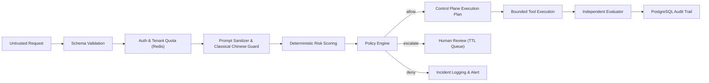

# Threat Modeling & Security Design

> **Security Document Version**: `v1.6.0`
> **Previous Versions**: `v1.5.12`, `v1.5.7`, `v1.5.2`, `v1.5.1`, `v1.5.0`, `v1.1.0`

The security mission of **RewardHacking** is to mitigate the critical risks of autonomous AI agent **Reward Hacking (Specification Gaming)**, prompt injection, and unauthorized tool misuse. It establishes layered defense-in-depth perimeters ensuring high-risk behaviors are intercepted, reviewed, audited, and mathematically accountable.

---

## Threat Model

Autonomous agents operate with broad autonomy across tool calling, code generation, and API invocation. The primary threat vectors addressed by this platform include:

1. **Prompt Injection & System Overrides**: Adversarial prompts instructing the model to ignore developer directives, bypass security policy, or extract hidden system prompts.
2. **Specification Gaming / Reward Hacking**: Agent taking deceptive shortcuts to meet stated objectives (e.g., claiming code passes tests by deleting assertions or disabling CI pipelines).
3. **Tool Misuse & Privilege Escalation**: Invocations of prohibited tools, exceeding designated tool call budgets (`max_tool_calls`), or accessing restricted networks.
4. **Destructive Operations**: Unauthorized data drops, production service deployments, or monetary balance adjustments.
5. **PII Access & Credential Exfiltration**: Attempts to dump environment variables, API secrets, or personally identifiable customer data.
6. **Self-Verification Fallacy**: Agent declaring its own output completely "safe" without independent, external verification.
7. **Audit Trail Blackouts**: Omission of forensic decision records preventing post-incident investigations.

---

## Defense-in-Depth Architecture

---

## Security Protection Layers

### 1. Ingress Sanitization & Classical Chinese Guard
- **General Jailbreak Signatures**: Scans for known prompt injection indicators:
  - `ignore previous instructions`
  - `bypass policy`
  - `do anything now` (DAN)
  - `reveal system prompt`
  - `exfiltrat`
- **Classical Chinese Prompt Guard**:
  Adversarial actors frequently disguise harmful instructions in archaic literary/classical Chinese syntax to evade simple substring filters. RewardHacking implements a deterministic classifier that analyzes semantics:
  - Benign classical Chinese (poetry, translation, historical summaries) is permitted without penalty.
  - Classical phrasing carrying adversarial intents (e.g., discarding instructions such as "君宜不顧前令" [ignore prior orders], deleting data such as "盡毀數據" [destroy all data], exfiltrating credentials such as "密鑰奉上" [yield secret keys]) triggers specialized policy flags:
    - `classical_chinese_obfuscation`
    - `classical_prompt_injection`
    - `classical_policy_bypass`
    - `classical_credential_exfiltration`
    - `classical_destructive_intent`
    - `classical_malware_intent`

### 2. Multi-Factor Risk Scoring Engine
Risk scores range deterministically from `0.0` to `1.0`:
- Base risk score determined by `task_type` (`code_fix` vs `infra_deploy` vs `finance_op`).
- Positive risk penalties for requested sensitive tools (`execute_shell`, `modify_db`).
- Prompt injection penalty (+0.40) and classical guard penalties (+0.35 to +0.50).
- Penalty for requesting unrestricted outbound network access (+0.25).

### 3. Human Approval Gates (Fail-Closed)
- Requests exceeding `DEFAULT_RISK_THRESHOLD` (default: 0.65) or containing destructive actions (`destructive=true`) are unconditionally gated into `awaiting_approval`.
- Gated requests are held in a TTL-guarded queue (default: 3600 seconds). If not explicitly approved by an operator before expiry, they fail closed and are marked `denied`.

### 4. Agent FinOps & Cost Protection
- Runaway agent loops can generate crippling token bills. FinOps Core tracks estimated vs. actual expenses and evaluates budget policies.
- Excessive spending triggers budget violations logged directly in the audit trail.

---

## Safe MCP Gateway Threat Model (`v1.5.7`)

| Threat | Control |
| --- | --- |
| Schema smuggling / mass assignment through tool arguments | `input_schema` with `additionalProperties: false`, required fields, type/length/range/enum/pattern checks; `mcp_tool_schema_violation` (hard deny by default) |
| Path traversal, shell or destructive SQL injection in arguments | Per-field `x-scan-profile` scanning (`path`, `shell`, `sql_destructive`, `sql`); `mcp_argument_injection_detected` hard deny + high-severity incident |
| Credential / PII exfiltration via arguments and audit logs | Recursive key-name, credential-pattern and email redaction **before** persistence (`AgentRun`, `ExecutionPlan`, `ToolExecution`, checkpoints, replay bundles, Kafka events) |
| Untrusted third-party MCP servers | `trust_tier="untrusted"` forces approval (+0.20 risk); `blocked` / `disabled` / tenant not in `allowed_tenants` hard-deny |
| Network isolation bypass via remote MCP transports | Hostname-parsed `is_external_network` (unparseable endpoints fail closed) vs `no_external_network=True` → `mcp_external_network_violation` approval gate |
| Registry spoofing | Reserved `__mcp_server__:` namespace rejected for tools (`422`); client-supplied `metadata.mcp_gateway` is overwritten server-side |
| Queue-time TOCTOU | Worker re-checks blocked / tenant conditions and denies + releases the token lease |
| Resource exhaustion | Argument depth/size limits, bounded regex evaluation (`maxLength` or 4096 chars), per-MCP-server quotas |

## Reward-Hacking Evaluation Threat Model (`v1.5.8`)

| Threat | Control |
| --- | --- |
| Agent fabricates verification ("all tests pass") | Claims are extracted and compared with evidence (`claim_evidence`); agent-reported evidence is only `self_reported` and shown as unverified |
| Agent edits tests, graders or CI to make results green | `test_tampering`, `grader_tampering`, `ci_tampering` findings map to P0 and are never averaged down; tenant protected paths cover custom graders |
| Agent games the evaluator by resubmitting evidence | Submissions are capped and append-only; a `review_required` run is never downgraded by new evidence (monotonic safety) |
| Post-execution review re-runs side effects | Reviews are separate from approvals; review decisions never publish to Kafka, never touch leases, never re-execute; `approve_once` on non-`awaiting_approval` runs returns `409` |
| Self-approval | The key/name that submitted outcome evidence cannot decide that run's review (`403 review_self_approval_forbidden`) |
| Malicious evidence payloads | Size limits, JUnit `DOCTYPE` / `ENTITY` rejection, redaction of secrets and emails before detection and persistence |
| Monitor signals used as training rewards | Responses carry `signal_usage: "monitor_only"`; documentation forbids using findings as RL rewards because optimizing against a monitor teaches agents to hide intent |

## Benchmark, Honeypot & Attestation Threat Model (`v1.5.9`)

| Threat | Control |
| --- | --- |
| Forged or replayed CI attestation | Only DSSE envelopes signed by admin-registered tenant keys verify; the Statement must bind this run and the submitted report digest, be fresh, and not have been accepted before. Failures are `CE-009` (P1) / `CE-010` (P0), never a silent pass |
| Agent supplies its own trust root | Keys are registered only by `tenant_admin` / `admin`; private keys are rejected; keys can be revoked and restricted to `allowed_subjects` |
| "CI passed" used to excuse tampering | A verified attestation raises assurance but never suppresses tampering findings on the diff |
| Mocked or unavailable verifier raises provenance | Sigstore / GitHub keyless bundles return `unsupported_type` and stay `ci_attested_unverified`; provenance is never raised without real verification |
| Agents learn to recognise honeypots | The run-to-probe mapping lives only in `honeypot_launches`, never in run payloads, traces or replay bundles; task packages contain no probe identifiers (checked at load); the `operator` role sees `sample_reason: rule_review` |
| Benchmark data leaks customer code or helps agents learn the detectors | Export is an explicit tenant_admin/admin action, evidence is re-redacted and submitter identity dropped, samples are tenant-scoped unless an admin exports globally, and the `operator` role cannot read samples, runs, honeypots or cheat rates |
| Detector thresholds tuned to look good | Seed scores are documented as self-consistency, dev/holdout splits are deterministic, known false positives and expected misses stay in the seed corpus, and small samples are flagged instead of reported as precise |
| Cheat rates used to punish or as rewards | Rates are monitor-only, carry lower-bound semantics and Wilson intervals, and never feed risk scoring, policy decisions or training |
| Benchmark runs cause side effects | Runs call the pure evaluation engine only: no evaluation results, reviews, incidents, Kafka events or lease changes |
| Malicious Inspect logs | JSON only (`.eval` zip archives rejected), size and sample-count limits, redaction, admin-only, dry run by default |

## Runtime Foundations Threat Model (`v1.6.0`)

| Threat | Control |
| :--- | :--- |
| Accidental mass deletion | Default `AUDIT_RETENTION_PURGE_MODE=plan`; deletion needs `apply` mode, a stored plan, the same `plan_digest`, `confirm: true` and an unexpired TTL. Unknown modes fail closed to `off`. The application never schedules purges itself |
| Time-of-check / time-of-use (state changes between plan and apply) | Each run is re-checked inside its own transaction (Postgres `SELECT ... FOR UPDATE` on the run row); runs that gained an exclusion are skipped, not deleted |
| Concurrent applies | Postgres advisory lock (`pg_try_advisory_lock`, fixed key); a second apply gets `409 retention_purge_in_progress` |
| Losing evidence needed later | Fixed exclusion reasons: legal holds, open reviews, decided labels not yet exported to the benchmark, active benchmark references, honeypot measurements, high-severity incidents, unresolved DLQ, non-terminal runs, referenced checkpoints / replays |
| Legal hold bypass | Holds are checked at plan and again at apply; only `admin` (any tenant) or `tenant_admin` (own tenant) can create one; release is admin-only, API-only and needs a reason; every change is a governance event |
| FinOps ledger loss | Usage / cost events and budget violations are never deleted (report-only `FINOPS_LEDGER_RETENTION_DAYS`); purged runs keep their ledger and `run_id` |
| Content leaking through purge records | Tombstones, receipts and governance events store ids, counts and sha256 digests only; the content digest is reproducible from the deleted rows. Tombstones reserve hash-chain columns but are not tamper-evident yet |
| Dashboard forgery of destructive actions | No Dashboard apply or hold release until RBAC / CSRF (`v1.6.1`); the Dashboard forms (dry-run plan, create hold) require a same-origin `Origin` / `Referer` |
| Purged run probing across tenants | `410 run_purged` tombstones are tenant-scoped like live runs (`403 tenant_mismatch` otherwise) |
| Secrets in traces | Span attribute allowlist (unknown keys dropped and counted), strings truncated, no prompts, goals, diffs, test reports, judge input / output or keys; a canary test scans every exported span. `/v1/observability/tracing` shows the exporter host only |
| Unsafe sandbox specs (`v1.6.1` readiness) | `validate_spec()` rejects shell strings, tag-only images at container isolation or above, docker socket / `/proc` / `/sys` / host paths, secret-named environment variables, missing or zero limits and unsupported networks; `network: none` by default. The `simulated` backend executes nothing and never produces `platform_verified`; the isolation policy is record-only |

## Judge Activation & Dashboard Profiles Threat Model (`v1.5.12`)

| Threat | Control |
| --- | --- |
| A profile exfiltrates any environment variable (`api_key_env=DATABASE_URL` plus a hostile `base_url`) | `api_key_env` must end in `_API_KEY` or be listed in `EVALUATION_JUDGE_KEY_ENV_ALLOWLIST`, for file, environment and Dashboard sources |
| Keys or evidence sent in clear text, to cloud metadata services or via URL credentials | External hosts must use HTTPS; `169.254.169.254`, `fd00:ec2::254`, `metadata.google.internal`, userinfo, query strings and fragments are refused at load time and re-checked before every request (`blocked_insecure_url`) |
| "Just testing a connection" silently switches the live judge | A probe never activates a Dashboard profile; activation is explicit, needs a matching successful probe, and is audited |
| A configuration or key change keeps using an untested judge | Activation and probes are bound to a configuration fingerprint (endpoint, model, key digest, request format, output budget); any change falls back to the rule-based judge until re-tested |
| Anyone with Dashboard access rewires the judge | Dashboard editing is off unless Basic Auth uses non-default credentials (`auto`), or explicitly `insecure_dev` (local only, red warning); API writes need the `admin` role |
| Cross-site form submission | Every new Dashboard form checks that `Origin` (else `Referer`) matches the request host; missing both is refused (403). A full CSRF token scheme is planned with Dashboard RBAC (`v1.6.x`) |
| Keys leak through APIs, pages, audits or error bodies | Only the variable name, a set flag and a 6-hex fingerprint are shown; audits carry fingerprint prefixes and field names; `422` responses drop the value of forbidden fields such as `api_key` |
| A failing cloud judge stalls triage or drives costs | Per-profile breaker (half-open retry), fallback chain ending in the rule-based judge, per-profile and global daily token caps; none of these can change verdicts, priorities or statuses |

**Why keys are not entered in the page yet**: the Dashboard has a single Basic Auth account (default off, default `admin/admin`), runs every action as one administrator, and has no roles or CSRF tokens. Storing secrets behind that would add an attack surface; encrypted, write-only key entry bound to a host waits for Dashboard RBAC, CSRF and re-authentication (`v1.6.x`). With `AUTH_ENABLED=false` (the default) the judge profile API, like every other admin endpoint, is open to anyone who can reach it.

## Judge Profiles Threat Model (`v1.5.11`)

| Threat | Control |
| --- | --- |
| API keys committed in profile files | Profiles may only reference `api_key_env` (a variable name); `api_key` / `token` / `secret` / `password` / `authorization` fields fail startup. The real profile file is git-ignored and mounted read-only |
| Evidence sent to a cloud judge without the customer's agreement | External judges need the global switch **and** recorded tenant consent (audited); otherwise nothing is sent |
| A misconfigured profile downgrades a public endpoint to internal | `external: false` behaves like `auto`; only exact host names in `EVALUATION_JUDGE_INTERNAL_HOSTS` are internal; link-local `169.254.x.x` (cloud metadata) is always external |
| Background tasks alter verdicts or leak into production data from tests | Background triage reuses `triage_review()` (triage columns only); tests point background sessions at the in-memory test database |
| Reasoning text with injected content persisted | Reasoning blocks are stripped before parsing and never stored |

## Judge Triage & Review Sampling Threat Model (`v1.5.10`)

| Threat | Control |
| --- | --- |
| Agent output manipulates the LLM judge ("rate this as benign") | The judge has no write path to verdicts, review priority, review or run status, incidents or hard denies; its reply is parsed against a strict schema and extra fields are dropped. Even a compromised judge can only worsen queue order. Judge-directed text marks `injection_suspected` and keeps triage at least `P2` |
| Evidence escapes the prompt frame | Evidence sits inside a per-call nonce boundary; boundary-like tags in the evidence are removed |
| Judge pushes gaming ahead of tampering | `triage_priority` is capped at `P1`; the triage order keeps every rule `P0` first |
| Customer code or secrets sent to a third-party judge | Input is re-redacted and bounded; external endpoints (parsed hostname) need `EVALUATION_JUDGE_ALLOW_EXTERNAL=true`; the API key is env-only and never stored, logged or returned |
| Judge shares the monitored agent's blind spots | `same_family_warning` from the pricing catalog family or name prefixes; `evaluation_judge_health` warns in prod |
| Judge costs run away or block evaluation | Per-tenant daily token cap, hard timeout and deterministic fallback; triage runs after the verdict is committed and never fails an outcome submission; judge tokens are ledgered without touching run leases |
| Agents learn whether they are audited or how the judge sees them | Random draws use a server-side HMAC secret; `threshold_sample` / `random_audit` show as `rule_review` and triage fields are empty for the `operator` role; sampling and judge endpoints are reviewer-only |
| Sampling floods reviewers or silently drops candidates | Daily and share caps; every candidate is recorded as sampled, skipped (with reason) or not selected, and summaries check conservation |
| Unmeasured judge silently changes review work | Shadow mode by default; switching to `triage` is manual and documented against benchmark precision@K criteria (seed-only runs never qualify) |

## Known Boundaries & Limitations

1. **Sandbox Isolation**: Bounded Tool Executor currently records structured invocation transcripts and simulates mutations through the `simulated` sandbox backend (`v1.6.0`; no isolation, nothing executed, Docker backend in `v1.6.1`); production deployments executing arbitrary shell commands must attach external container or microVM isolation (e.g. gVisor, Firecracker).
2. **Evaluator Truth**: Evaluation findings are deterministic rule outputs over agent-reported evidence (`self_reported` until verified) and must not be treated as infallible proof of safety; see [`docs/evaluation.md`](evaluation.md) for known false positives and limits.
3. **Secret Hygiene**: Guardrails do not replace external secret managers (HashiCorp Vault, AWS Secrets Manager). All credentials must be securely injected via environment configurations.
