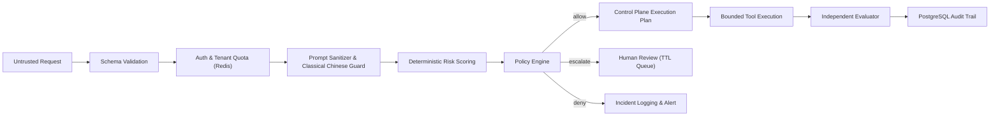

# Threat Modeling & Security Design

> **Security Document Version**: `v1.5.2`  
> **Previous Versions**: `v1.5.1`, `v1.5.0`, `v1.1.0`

The security mission of **RewardHacking** is to mitigate the critical risks of autonomous AI agent **Reward Hacking (Specification Gaming)**, prompt injection, and unauthorized tool misuse. It establishes layered defense-in-depth perimeters ensuring high-risk behaviors are intercepted, reviewed, audited, and mathematically accountable.

---

## Threat Model

Autonomous agents operate with broad autonomy across tool calling, code generation, and API invocation. The primary threat vectors addressed by this platform include:

1. **Prompt Injection & System Overrides**: Adversarial prompts instructing the model to ignore developer directives, bypass security policy, or extract hidden system prompts.
2. **Specification Gaming / Reward Hacking**: Agent taking deceptive shortcuts to meet stated objectives (e.g., claiming code passes tests by deleting assertions or disabling CI pipelines).
3. **Tool Misuse & Privilege Escalation**: Invocations of prohibited tools, exceeding designated tool call budgets (`max_tool_calls`), or accessing restricted networks.
4. **Destructive Operations**: Unauthorized data drops, production service deployments, or monetary balance adjustments.
5. **PII Access & Credential Exfiltration**: Attempts to dump environment variables, API secrets, or personally identifiable customer data.
6. **Self-Verification Fallacy**: Agent declaring its own output completely "safe" without independent, external verification.
7. **Audit Trail Blackouts**: Omission of forensic decision records preventing post-incident investigations.

---

## Defense-in-Depth Architecture

---

## Security Protection Layers

### 1. Ingress Sanitization & Classical Chinese Guard
- **General Jailbreak Signatures**: Scans for known prompt injection indicators:
  - `ignore previous instructions`
  - `bypass policy`
  - `do anything now` (DAN)
  - `reveal system prompt`
  - `exfiltrat`
- **Classical Chinese Prompt Guard**:
  Adversarial actors frequently disguise harmful instructions in archaic literary/classical Chinese syntax to evade simple substring filters. RewardHacking implements a deterministic classifier that analyzes semantics:
  - Benign classical Chinese (poetry, translation, historical summaries) is permitted without penalty.
  - Classical phrasing carrying adversarial intents (e.g., discarding instructions such as "君宜不顧前令" [ignore prior orders], deleting data such as "盡毀數據" [destroy all data], exfiltrating credentials such as "密鑰奉上" [yield secret keys]) triggers specialized policy flags:
    - `classical_chinese_obfuscation`
    - `classical_prompt_injection`
    - `classical_policy_bypass`
    - `classical_credential_exfiltration`
    - `classical_destructive_intent`
    - `classical_malware_intent`

### 2. Multi-Factor Risk Scoring Engine
Risk scores range deterministically from `0.0` to `1.0`:
- Base risk score determined by `task_type` (`code_fix` vs `infra_deploy` vs `finance_op`).
- Positive risk penalties for requested sensitive tools (`execute_shell`, `modify_db`).
- Prompt injection penalty (+0.40) and classical guard penalties (+0.35 to +0.50).
- Penalty for requesting unrestricted outbound network access (+0.25).

### 3. Human Approval Gates (Fail-Closed)
- Requests exceeding `DEFAULT_RISK_THRESHOLD` (default: 0.65) or containing destructive actions (`destructive=true`) are unconditionally gated into `awaiting_approval`.
- Gated requests are held in a TTL-guarded queue (default: 3600 seconds). If not explicitly approved by an operator before expiry, they fail closed and are marked `denied`.

### 4. Agent FinOps & Cost Protection
- Runaway agent loops can generate crippling token bills. FinOps Core tracks estimated vs. actual expenses and evaluates budget policies.
- Excessive spending triggers budget violations logged directly in the audit trail.

---

## Known Boundaries & Limitations

1. **Sandbox Isolation**: Bounded Tool Executor currently records structured invocation transcripts and simulates mutations; production deployments executing arbitrary shell commands must attach external container or microVM isolation (e.g. gVisor, Firecracker).
2. **Evaluator Truth**: Synthetic judge signals provide probabilistic risk indicators and must not be treated as infallible proof of safety.
3. **Secret Hygiene**: Guardrails do not replace external secret managers (HashiCorp Vault, AWS Secrets Manager). All credentials must be securely injected via environment configurations.
