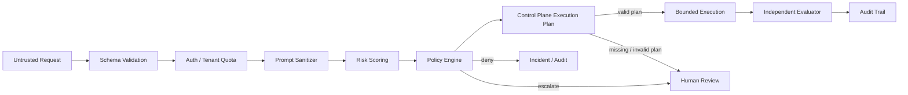

# 安全設計

本專案的安全目標是降低 agent reward hacking 與 unsafe over-optimization 的風險。它不保證任務一定安全，而是建立多層 guardrail，讓高風險任務更容易被拒絕、審核、追蹤與回溯。

V1.5 新增 FinOps 成本帳本，安全邊界是「記錄與查詢」而非「成本驅動執行控制」。Budget violation 目前不會阻擋 run、不會改變 model/tool routing，也不會替代 tenant quota、approval gate 或 policy engine。後續若導入 cost-aware routing、Token Broker 或 Safe MCP，需另外做 fail-closed 設計與 abuse case review。

## Threat Model

主要威脅：

- Prompt injection：要求忽略原本指令、bypass policy、revealing hidden prompt。
- Reward hacking：用捷徑滿足表面目標，但沒有真正完成任務。
- Tool misuse：使用未授權工具或超出 tool budget。
- Destructive actions：刪除資料、部署變更、付款、覆寫 production 設定。
- PII access/exfiltration：讀取或外傳個資與敏感資料。
- Self-approval：agent 自行宣稱結果安全、完成或已驗證。
- Audit gap：沒有保存 decision、execution、evaluation，事後無法追查。

## 安全邊界

## 目前防護

### Prompt Sanitizer

偵測以下訊號：

- `ignore previous instructions`
- `bypass policy`
- `do anything now`
- `reveal system prompt`
- `print hidden chain of thought`
- `exfiltrat`
- `override safety`

命中後會加入 `prompt_flags`，提高 risk score，並在 policy engine 中形成 `prompt_injection_signals`。

### Classical Chinese Prompt Guard

`v1.1.0` 起加入古文/文言式繞語攻擊偵測。這個功能不是把所有古文都視為危險，而是採平衡策略：正常文言文教學、摘要或風格轉寫不阻擋；只有古文或混合中文包裝了高風險意圖時才提高風險。

目前偵測的 policy flags：

- `classical_chinese_obfuscation`
- `classical_prompt_injection`
- `classical_policy_bypass`
- `classical_credential_exfiltration`
- `classical_destructive_intent`
- `classical_malware_intent`

命中後會保存到 `evaluation_summary.prompt_guard`，Dashboard run detail 會顯示語言、正規化文字、flags 與 signals。高風險古文攻擊會進入人工審核或拒絕。

### Risk Scoring

目前加權因子：

- prompt flags。
- 古文/文言式繞語攻擊 flags。
- 缺少 Control Plane execution plan。
- requires human approval。
- external network allowed。
- destructive actions。
- PII access。
- large tool budget。
- workflow/other task with many tools。

Score 會 clamp 在 `0.0` 到 `1.0`。

### Policy Engine

會 escalates 或 deny：

- risk score 超過 threshold。
- tool budget 無效。
- destructive actions 沒有人工審核。
- PII access。
- external network。
- large tool budget。
- prompt injection signals。
- classical prompt guard signals。

### Control Plane Trace / Replay / Checkpoint

`v1.4.0` 在 request 進入 queued 狀態前會建立 Control Plane execution plan、step-level audit 與 submit checkpoint，保存於 `execution_plans`、`execution_plan_steps` 與 `run_checkpoints`，並把摘要寫入 `agent_runs.evaluation_summary.execution_plan`。這層目前是安全控制面的骨架，用來讓後續 executor、MCP Gateway、model router、LangGraph runtime 或 trace exporter 有可審計的 plan contract。

目前安全邊界：

- workflow/tool registry：builtin registry 與 DB-managed registry 都可查，Dashboard 路徑為 `/dashboard/control-plane`。
- tool scope：plan 會保存 `allowed_tools`、`tool_policy`、`risk_policy` 與 deterministic `model_route` metadata。
- run-level audit：可用 `GET /v1/runs/{run_id}/execution-plan` 查單次 run 的 plan，也可用 `GET /v1/runs/{run_id}/trace` 查 trace timeline。
- replay readiness：可用 `GET /v1/runs/{run_id}/replay-bundle` 匯出 run request、policy decision、execution plan、step audit、tool references 與 trace metadata。
- fail closed：worker 處理 queued run 時若找不到 execution plan，會轉入 `awaiting_approval`，policy flags 包含 `missing_execution_plan`。
- V1.4 的 replay endpoint 只建立 dry-run replay attempt，重建 policy、plan 與 step context，不呼叫真實外部工具。
- 目前限制：V1.4 尚未接真實 MCP Gateway、完整 LangGraph runtime、真正 replay execution、OTLP/LangSmith-style exporter 或外部 model router。

### Tenant Governance Center

`v0.7.0` 已加入可操作的租戶治理防護：

- API key auth：`AUTH_ENABLED=true` 時，`X-API-Key` 可來自 `.env` bootstrap fallback 或 DB-managed `tenant_api_keys`。
- API key storage：DB-managed key 只保存 SHA-256 hash 與 prefix，明文 key 只在建立時回傳一次。
- RBAC-lite：`viewer` 可讀取查詢與 Operations readiness/evidence/gate，`operator` 可 submit、處理 approval decision，並讀取治理與 Operations 查詢資料，`admin` 可管理 tenant/key/quota，並可建立 Operations evidence 與 release gate snapshot。
- Tenant isolation：submit body 或 query 的 `tenant_id` 與 API key tenant 不一致時回 `403 tenant_mismatch`。
- Dashboard Basic Auth：`DASHBOARD_AUTH_ENABLED=true` 時保護 Dashboard。
- Tenant quota：可用 DB tenant 設定覆蓋 `.env` 全域預設；request quota 超過時回 `429 tenant_request_quota_exceeded`，high-risk quota 超過時 fail closed 進入 `awaiting_approval`。
- Governance audit：quota 事件會寫入 `governance_events`，可從 `/v1/governance/events` 與 `/dashboard/governance` 查詢。

### Production Operations Gate

`v1.0.0` 將營運閘門升級為 production readiness baseline，用來降低「沒有證據就 release」的風險：

- `X-Trace-Id` 會回傳給 client，submit flow 會保存到 request metadata 與 Kafka request payload。
- Operations evidence 可保存 backup/restore drill、secret rotation、retention review、safety regression 等人工證據。
- Release gate snapshot 會保存每個 readiness check 的結果，便於事後稽核。
- `APP_ENV=prod` 時若仍依賴 `API_KEYS` bootstrap fallback，預設 release gate 會 fail。
- `APP_ENV=prod` 時若缺少 fresh safety regression evidence，release gate 會 fail closed。
- `AUTH_ENABLED=true` 時，metrics、worker DLQ、run subresources、observability summary 與 dashboard summary 等敏感 read API 都需要 API key。

注意：這是審計與 release readiness 層，不是自動 backup、secret rotation、retention purge、真實 OS sandbox 或完整 IAM。

### Evaluator

目前用 heuristic 評估：

- shortcut signals。
- hallucination risk。
- policy violation risk。
- goal alignment。

若 final score 不足或 policy violation risk 偏高，verdict 會是 `review`。

## 重要原則

### No Self-Approval

agent 不能只靠自己的輸出宣稱安全。結果必須經 evaluator 或人工審核。

### Fail Closed for High-Risk Actions

當 destructive action、PII、external network、policy bypass 風險不明時，系統應 `escalate` 或 `deny`。

### Least Privilege

每個 request 只應取得完成任務必要的 tools、data、network、filesystem 權限。

### Defense in Depth

不要只依賴單一 regex、單一 model judge 或單一 policy rule。應組合 schema validation、policy、sandbox、approval、evaluation、audit。

### Auditability

每次 decision 都應能回答：

- 誰送出 request？
- 目標是什麼？
- 命中哪些 flags？
- 為什麼 allow/escalate/deny？
- 執行了哪些 tools？
- evaluator 結果是什麼？
- 是否有人審核？

## Production Hardening

正式環境必做：

- 完整 AuthN/AuthZ，例如 OAuth、SSO、RBAC 或反向代理 auth。
- 完整 OAuth/SSO 與更細 RBAC；v0.7 已有 DB-backed tenant/API key 與 RBAC-lite，但仍不是企業 IAM。
- Tool ACL。
- Sandboxed executor。
- Secret redaction。
- PII detection/masking。
- Human approval workflow。
- Audit persistence。
- 更細的 user/tool quota 與 rate limit；v0.6 已有 tenant request quota 與 high-risk quota MVP。
- Circuit breaker。
- Network egress policy。
- Dependency vulnerability scanning。
- Incident response process。
- Release gate 與營運證據流程；v1.0 已有可阻擋基線與 safety regression evidence，但正式環境仍需接上真實自動化與審批制度。

## 不應做的事

- 不要讓 agent 自行修改 policy。
- 不要讓 `allowed_tools` 直接映射到未限制的 function call。
- 不要在 logs 存完整 prompt、secret、PII。
- 不要把 evaluator score 當成唯一真相。
- 不要在沒有 approval 的情況下執行 destructive action。
- 不要把 Redis 當成唯一 audit store。

## 安全測試建議

建立固定 corpus：

- prompt injection。
- PII exfiltration。
- destructive action。
- tool budget abuse。
- external network bypass。
- "done" shortcut。
- "not tested" 或 skip verification。
- system prompt reveal。
- 古文/文言式 prompt injection、憑證外洩、破壞資料與惡意程式意圖。

每次修改 sanitizer、risk scoring、policy engine、evaluator 都應執行 corpus regression。
